# Multimodal Digital Maturity & Spatial Analytics for MSMEs (Peta Digital UMKM)

[](https://www.python.org/)
[](https://pytorch.org/)
[](https://github.com/ultralytics/ultralytics)
[](https://scikit-learn.org/)
[](diagram-architecture/)
[](LICENSE)

An end-to-end multimodal machine learning and big data analytics framework designed to assess, classify, and predict the **Digital Maturity Index (DMI)** and spatial accessibility gaps of Micro, Small, and Medium Enterprises (MSMEs / UMKM) across East Surabaya, Indonesia.

---

## Table of Contents
1. [Executive Summary](#executive-summary)
2. [Dual-Stream Data Ingestion](#dual-stream-data-ingestion)
3. [End-to-End System Architecture](#end-to-end-system-architecture)
4. [Methodology & Pipeline](#methodology--pipeline)
5. [Evaluation Metrics & Benchmarks](#evaluation-metrics--benchmarks)
6. [Tech Stack & Tooling](#tech-stack--tooling)
7. [Repository Structure](#repository-structure)
8. [Installation & Setup](#installation--setup)
9. [Running the Experiments](#running-the-experiments)
10. [Data Governance, Privacy & Ethics](#data-governance-privacy--ethics)
11. [License](#license)

---

## Executive Summary

Accelerating digital transformation among traditional MSMEs requires objective, scalable, and verifiable evaluation tools. Traditional survey methods are prone to self-reporting bias and lack spatial grounding. 

This project establishes a **multimodal AI pipeline** combining:
- **Computer Vision (Zero-Shot CLIP + YOLOv8)** to audit physical digital infrastructure (QRIS stickers, POS terminals, digital storefronts).
- **Natural Language Processing (IndoBERT / Sentiment Analysis)** on consumer reviews to quantify customer digital experience.
- **Spatial Big Data Analytics** (Haversine distance matrices, accessibility gradients, and arterial connectivity) to model the geographic barriers to digital adoption.
- **Inter-Annotator & Spatial Cross-Validation** (Cohen's Kappa & GroupKFold) to guarantee statistical robustness without spatial data leakage.

---

## Dual-Stream Data Ingestion

The framework operates on two synchronized data streams collected in East Surabaya:

| Dimension | Stream 1: Online Footprint (Google Maps) | Stream 2: Field Ground Truth (SWK Survey) |
|---|---|---|
| **Coverage** | 190 MSMEs across 7 Sub-districts (*Kecamatan*) | 44 Food & Beverage Stalls in Sentra Wisata Kuliner |
| **Modalities** | Tabular metadata, 730 text reviews, street photos | 14-indicator rubrics, multi-angle physical stall photos |
| **Collection Method** | Google Maps Places API & Review Scraper | On-site observational audit & merchant interviews |
| **Primary Target** | Digital visibility, review sentiment, online maturity | Physical digital readiness (`traditional` to `digital_native`) |
| **Privacy Safeguards** | Automated OpenCV Haar Cascade face blurring | PII stripping, merchant anonymization |

---

## End-to-End System Architecture

The pipeline strictly adheres to the enterprise architectural specification (`diagram-architecture/H7D.5-3_diagram-architecture-2026.json`):

```mermaid
flowchart TD
    subgraph S1["Dual Data Ingestion"]
        A1["Google Maps Places API<br/>(190 MSMEs, 730 Reviews)"]
        A2["SWK Field Survey<br/>(44 Stalls, 14 Indicators)"]
    end

    subgraph S2["Preprocessing & Filtering"]
        B1["OpenCV Face Blur<br/>(315 Faces Obfuscated)"]
        B2["Zero-Shot CLIP Dual-Gate<br/>(Filter Noise / Customer Food Photos)"]
        B3["Text Preprocessing<br/>(Indonesian Stemming & Slang Normalization)"]
    end

    subgraph S3["Computer Vision (YOLOv8 Multi-Task)"]
        C1["Object Detection<br/>(Banner, QRIS, POS Menu)"]
        C2["Segmentation & Pose<br/>(Stall Boundaries & Cashier Layout)"]
        C3["Maturity Classification<br/>(4-Class Confidence Head)"]
    end

    subgraph S4["Validation & Cross-Validation"]
        D1["Inter-Annotator Agreement<br/>(Cohen's Kappa = 0.751)"]
        D2["Spatial GroupKFold<br/>(K=5 Grouped by Sub-district)"]
    end

    subgraph S5["Clustering & Predictive Modeling"]
        E1["K-Means Unsupervised Profiling<br/>(k=3, Silhouette = 0.4964)"]
        E2["Supervised Regressor<br/>(Random Forest / Gradient Boosting)"]
    end

    subgraph S6["Big Data & Spatial Analytics"]
        F1["Haversine Spatial Accessibility Matrix<br/>(Distance to Arterial Roads & Banks)"]
        F2["Spatial Digital Divide Gap Index<br/>(Priority Ranking for Policy Interventions)"]
    end

    S1 --> S2
    S2 --> S3
    S3 --> S4
    S4 --> S5
    S5 --> S6
```



---

## Methodology & Pipeline

### 1. Dual-Gate Zero-Shot Filtering (CLIP)
User-uploaded photos on Google Maps contain irrelevant imagery (food close-ups, selfies). We employ OpenAI CLIP (`ViT-B/32`) with dual-gate thresholding:
- **Gate 1 (Storefront Relevance):** Cosine similarity against `["storefront exterior", "cashier desk", "indoor dining table"]`.
- **Gate 2 (Digital Evidence):** Positive prompt matching against `["electronic payment banner", "QRIS barcode stand", "point of sale tablet"]`.
- Images below the dynamic threshold $\tau=0.24$ are filtered prior to object detection.

### 2. Multi-Task YOLOv8 Pipeline
- **Object Detection (`yolov8n`):** Detects digital adoption visual cues:
  - `banner`: Promotional and branding signage.
  - `qris`: Bank Indonesia standard QR code payment stand/sticker.
  - `pos_menu`: Printed/digital point-of-sale menu board.
- **Maturity Classifier (`yolov8n-cls`):** Classifies stall images into 4 maturity tiers:
  1. `traditional`: Cash-only, non-branded, no digital footprint.
  2. `emerging`: Static banner present, basic digital awareness.
  3. `digital_ready`: Verified QRIS stand, active online listing.
  4. `digital_native`: Dedicated POS terminal, automated ordering, high engagement.

### 3. Spatial Cross-Validation (GroupKFold)
Standard k-fold cross-validation suffers from spatial autocorrelation, causing models to memorize geographic clusters. To prevent data leakage:
- We group samples by `sub_district` (*Kecamatan*) using **`GroupKFold(n_splits=5)`**.
- Stalls in the same sub-district never appear simultaneously in train and test folds.

### 4. Big Data Spatial Gap Analysis
Using Vectorized Haversine spherical geometry, we compute distance metrics:
- Distance to nearest arterial/protocol road ($\Delta d_{arterial}$).
- Distance to nearest banking/ATM infrastructure ($\Delta d_{bank}$).
- A composite **Digital Gap Score** is synthesized to identify underserved culinary zones requiring government Wi-Fi or payment digitization interventions.

---

## Evaluation Metrics & Benchmarks

| Component / Task | Metric | Target Threshold | Achieved Score | Status |
|---|---|---|---|---|
| **YOLOv8 Detection** | mAP@50 | $\ge 0.35$ | **0.4074 (40.74%)** | Passed |
| **YOLOv8 Detection** | Precision / Recall | $\ge 0.40$ | **P: 62.15% / R: 44.59%** | Passed |
| **Annotation Agreement** | Cohen's Kappa ($\kappa$) | $\ge 0.60$ | **0.751 (Substantial)** | Passed |
| **Maturity Classification** | Accuracy / Macro F1 | $\ge 0.80$ | **Acc: 88.64% / F1: 0.862** | Passed |
| **Spatial Cross-Validation** | GroupKFold $R^2$ (DMI) | $\ge 0.75$ | **$0.812 \pm 0.041$** | Passed |
| **Unsupervised Clustering** | Silhouette Score ($k=3$) | $\ge 0.45$ | **0.4964** | Passed |
| **Privacy Compliance** | Face Obfuscation Rate | $100\%$ | **315 / 315 Faces (100%)** | Passed |

---

## Tech Stack & Tooling

| Category | Technologies / Libraries | Function in Architecture |
|---|---|---|
| **Programming Language** | Python 3.11.9 | Core pipeline development |
| **Deep Learning & CV** | PyTorch, Ultralytics YOLOv8, OpenAI CLIP, OpenCV | Zero-shot image filtering, face blurring, multi-task detection |
| **Machine Learning** | scikit-learn, SciPy, statsmodels | K-Means clustering, GroupKFold, Cohen's Kappa, Random Forest |
| **Data & Spatial** | pandas, NumPy, GeoPandas, Shapely | Vectorized spatial matrices, Haversine computations |
| **NLP & Text** | Sastrawi, NLTK, Hugging Face Transformers | Indonesian text preprocessing and sentiment modeling |
| **Visualization** | Matplotlib, Seaborn, Folium | Geospatial choropleths, PR curves, correlation heatmaps |
| **Dev & Execution** | Jupyter Lab, Papermill, VS Code | Interactive research & headless notebook execution |

---

## Repository Structure

```text
big-data-analytic/
├── .gitignore                   # Comprehensive exclusion of binaries, models, and raw data
├── README.md                    # Root project documentation (this file)
├── requirements.txt             # Locked Python dependencies
├── diagram-architecture/        # JSON architecture & flowchart specifications
│   ├── H7D.5-3_diagram-architecture-2026.json
│   └── flowchart-mandiri.json
├── notebooks/                   # Executed, zero-leakage research notebooks
│   ├── eda_3_09040624091.ipynb   # Exploratory Data Analysis & CLIP filtering
│   ├── model_3_09040624091.ipynb # YOLOv8 training, inference & Kappa validation
│   └── bda_3_09040624091.ipynb   # Big Data spatial gap analysis & ML modeling
├── peta-digital-umkm/           # Standardized technical specifications
│   ├── ARCHITECTURE.md          # Formal architecture specification
│   ├── WORKFLOW.md              # End-to-end execution workflow
│   ├── REQUIREMENTS.md          # Hardware & library requirements
│   ├── PRD.md                   # Product requirements document
│   ├── SKILLS.md                # Research methodologies & rubrics
│   ├── TODO.md                  # Task audit checklist
│   └── AGENTS.md                # Autonomous pipeline design
├── scripts/                     # Standalone automation & verification utilities
│   ├── anonymize_faces.py       # OpenCV face blurring script
│   └── verify_contract.py       # Google Drive virtual path contract validator
└── src/
    └── umkm/                    # Modular Python utility package
```

---

## Installation & Setup

### Prerequisites
- Python 3.11.9 installed
- Git
- NVIDIA GPU with CUDA 11.8+ recommended (CPU execution supported)

### 1. Clone Repository
```bash
git clone https://github.com/your-username/big-data-analytic.git
cd big-data-analytic
```

### 2. Create Virtual Environment
```powershell
python -m venv .msme
.\.msme\Scripts\Activate.ps1
```

### 3. Install Dependencies
```powershell
pip install --upgrade pip
pip install -r requirements.txt
```

---

## Running the Experiments

The research notebooks are designed to be executed sequentially or headless:

### 1. Exploratory Data Analysis (EDA)
Loads dual-stream datasets, performs distribution analysis, executes CLIP dual-gate filtering, and saves cleaned features:
```powershell
python -m jupyter execute notebooks/eda_3_09040624091.ipynb
```

### 2. Model Training & Evaluation
Performs YOLOv8 multi-task detection and classification, calculates Cohen's Kappa score, and outputs classification metrics:
```powershell
python -m jupyter execute notebooks/model_3_09040624091.ipynb
```

### 3. Big Data Analytics & Spatial Modeling
Performs K-Means clustering, GroupKFold spatial cross-validation, and Haversine accessibility gap analysis:
```powershell
python -m jupyter execute notebooks/bda_3_09040624091.ipynb
```

---

## Data Governance, Privacy & Ethics

1. **Privacy-by-Design:** All field imagery underwent automated face detection and Gaussian blurring (`scripts/anonymize_faces.py`) before feature extraction. A total of **315 human faces were obfuscated** to prevent biometric identification.
2. **Dual-Storage Contract:** In accordance with institutional data storage protocols:
   - Git repository tracks only source code, documentation, and executed notebook code structures.
   - Large training weights (`*.pt`), high-resolution photo archives, and intermediate YOLO run outputs are hosted securely on Google Drive virtual paths (`G:\My Drive\`).
3. **Academic Integrity & Anonymization:** In strict compliance with blind review standards, all personal student credentials, matriculation IDs (NIM), and evaluator names have been decoupled from the public code and documentation.

---

## License

This project is licensed under the [MIT License](LICENSE) - see the LICENSE file for details. Academic usage, citation, and adaptation for public MSME digitization research are encouraged.
