# ARCHITECTURE — Peta Digital UMKM Kuliner Surabaya Timur

> **Status:** Final Terverifikasi · 4 November 2026  
> **Judul Diagram Arsitektur:** *Arsitektur Big Data & AI - Peta Digital UMKM Kuliner Surabaya Timur*  
> **Konvensi Alur Diagram:**
> - **Panah satu arah ($\longrightarrow$):** Alur data utama (*primary data flow*).
> - **Panah dua arah ($\longleftrightarrow$):** Pertukaran data, artefak, atau log (*bidirectional data/artifact/log exchange*).
> - **Kotak komponen:** Berisi modul, library, dan framework spesifik pada setiap lapisan.

---

## 1. Gambaran Umum Arsitektur Big Data & AI (`mxGraphModel`)

Arsitektur sistem memadukan **13 blok utama** (termasuk sub-blok terstruktur pada *Data Transformation* dan *Analytics Operating System*) yang memproses 4 modalitas data (Teks Ulasan, Data Numerik, Dokumen PDF, dan Citra Visual) dari hulu ke hilir:

$$\text{DATA SOURCES} \longrightarrow \text{ETL (INGESTION)} \longrightarrow \text{DATA STORAGE} \longleftrightarrow \text{Data Transformation} \longleftrightarrow \text{Analytics Operating System} \longrightarrow \text{Model Evaluation} \longrightarrow \text{Registry} \longrightarrow \text{Inferencing} \longrightarrow \text{Big Data Analytics (Spasial)} \longrightarrow \text{Visualization} \longrightarrow \text{AI Application}$$

Serta didukung oleh pertukaran dua arah ($\longleftrightarrow$) dengan blok **AI/ML Ops** dan **Feature Store**.

```mermaid
flowchart LR
  subgraph DS["DATA SOURCES"]
    s0["<b>s0: Google Maps</b><br/>Teks Ulasan & Foto"]
    s1["<b>s1: Kaggle</b><br/>Data Numerik & Gambar"]
    s2["<b>s2: Journal</b><br/>Data Dokumen (PDF)"]
    s3["<b>s3: Real World</b><br/>Foto & Survei Lapangan SWK"]
  end

  subgraph ETL["ETL (INGESTION)"]
    e0["<b>e0: Google Places API & REST HTTP</b><br/>Data lokasi, rating, ulasan, foto"]
    e1["<b>e1: KaggleHub CLI</b><br/>Dataset numerik & gambar"]
    e2["<b>e2: Google Drive API & Manual Download</b><br/>PDF jurnal & regulasi"]
    e3["<b>e3: Manual Foto & Google Forms</b><br/>Survei lapangan SWK"]
    e4["<b>e4: Pandas & PySpark</b><br/>Gabung batch JSON & CSV"]
    e5["<b>e5: Google Sheet</b><br/>Katalog & skema data"]
  end

  subgraph ST["DATA STORAGE"]
    c0[("<b>c0: Raw Data</b><br/>Google Drive<br/>JSON, CSV, PDF, Foto")]
    c1[("<b>c1: Processed Data</b><br/>Google Drive<br/>Parquet bersih")]
    c2[("<b>c2: Output Data</b><br/>Google Drive<br/>Model, peta, laporan")]
  end

  subgraph OPS["AI/ML Ops"]
    o0["<b>o0: MLflow & DVC</b><br/>Log eksperimen & versi data"]
    o1["<b>o1: Git / GitHub</b><br/>Versi kode"]
    o2["<b>o2: Google Colab</b><br/>+ VS Code (CPU/GPU)"]
  end

  subgraph DT["Data Transformation"]
    subgraph PR["Processing"]
      p0["<b>p0: Regex & NLTK</b><br/>Cleaning teks ulasan, stopwords, sensor PII"]
      p1["<b>p1: PyMuPDF & pdfplumber</b><br/>Ekstrak teks & tabel PDF"]
      p2["<b>p2: OpenCV</b><br/>Cek foto duplikat, blur wajah, resize"]
      p3["<b>p3: Albumentations</b><br/>Augmentasi gambar"]
      p4["<b>p4: Pandas & SciPy</b><br/>Imputasi, outlier IQR, validasi QRIS/EDC/POS"]
      p5["<b>p5: Pillow</b><br/>Baca & konversi format foto"]
    end
    subgraph EDA["Exploratory Data Analysis (EDA)"]
      d0["<b>d0: ydata-profiling</b><br/>Profil otomatis dataset Maps, Kaggle, survei"]
      d1["<b>d1: Seaborn & Matplotlib</b><br/>Sebaran rating & ulasan per wilayah"]
      d2["<b>d2: Matplotlib</b><br/>Bandingkan foto Gmaps vs Real World"]
    end
    subgraph FE["Feature Extraction & Engineering"]
      f0["<b>f0: IndoBERT & TF-IDF</b><br/>Vektor teks ulasan"]
      f1["<b>f1: Label Studio & Ultralytics YOLO</b><br/>Deteksi QRIS, EDC, POS, stiker merchant"]
      f2["<b>f2: ResNet-50</b><br/>Ekstraksi fitur visual merchant"]
      f3["<b>f3: Binary/Label Encoding</b><br/>Indikator QRIS/POS/EDC jadi 0/1"]
      f4["<b>f4: Sentence-Transformers</b><br/>Embedding chunk dokumen"]
      f5["<b>f5: scikit-learn Pipeline</b><br/>StandardScaler & PCA: fusi fitur"]
    end
  end

  subgraph AOS["Analytics Operating System"]
    subgraph ML["Machine Learning"]
      m0["<b>m0: scikit-learn</b><br/>K-Means, K-Prototypes, Random Forest, Logistic Regression"]
      m1["<b>m1: XGBoost</b><br/>Klasifikasi 3 kelas kematangan digital"]
      m2["<b>m2: NumPy</b><br/>Centroid optimization (ACO)"]
      m3["<b>m3: Joblib</b><br/>Simpan model & preprocessing"]
    end
    subgraph DL["Deep Learning Frameworks"]
      l0["<b>l0: PyTorch</b><br/>Backend deep learning"]
      l1["<b>l1: Hugging Face</b><br/>Transformers (IndoBERT)"]
      l2["<b>l2: Ultralytics</b><br/>YOLO deteksi objek"]
    end
  end

  subgraph FS["Feature Store"]
    fs0["<b>fs0: Google Drive</b><br/>Penyimpanan fitur"]
    fs1["<b>fs1: Apache Parquet</b><br/>PyArrow: matriks fitur"]
    fs2["<b>fs2: NumPy (.npy / .npz)</b><br/>Embedding teks & fitur gambar"]
    fs3["<b>fs3: Pandas DataFrame</b><br/>Tabel fitur & label"]
  end

  subgraph ME["Model Evaluation"]
    me0["<b>me0: scikit-learn Metrics</b><br/>macro-F1, accuracy, precision, recall"]
    me1["<b>me1: Silhouette Score</b><br/>Kualitas klaster K-Means"]
    me2["<b>me2: Cohen's Kappa</b><br/>Kesepakatan Maps vs lapangan"]
    me3["<b>me3: Ultralytics mAP</b><br/>Akurasi kotak deteksi"]
    me4["<b>me4: SHAP</b><br/>Pengaruh fitur"]
    me5["<b>me5: Grad-CAM</b><br/>Area fokus gambar"]
  end

  subgraph INF["Inferencing"]
    in0["<b>in0: FastAPI</b><br/>Endpoint Inference API"]
    in1["<b>in1: ONNX Runtime</b><br/>Prediksi model ONNX"]
    in2["<b>in2: scikit-learn Predict</b><br/>Klaster & kelas UMKM baru"]
    in3["<b>in3: Ultralytics YOLO Predict</b><br/>Deteksi indikator foto baru"]
  end

  subgraph REG["Registry"]
    rg0["<b>rg0: MLflow Model Registry</b><br/>Versi & stage model"]
    rg1["<b>rg1: ONNX (.onnx)</b><br/>Bobot model portabel"]
    rg2["<b>rg2: Joblib (.joblib)</b><br/>Model scikit-learn"]
    rg3["<b>rg3: YOLO Weights (.pt)</b><br/>Bobot detektor"]
  end

  subgraph BDA["Big Data Analytics (Spasial)"]
    bd0["<b>bd0: Pandas & PySpark</b><br/>Agregasi per kecamatan"]
    bd1["<b>bd1: GeoPandas & Shapely</b><br/>Titik ke poligon Surabaya Timur"]
    bd2["<b>bd2: PySAL, SciPy & statsmodels</b><br/>Statistik spasial & bias cakupan"]
    bd3["<b>bd3: Pandas</b><br/>Analisis gap digitalisasi wilayah"]
  end

  subgraph VIS["Visualization"]
    vz0["<b>vz0: Folium & Plotly</b><br/>Peta interaktif 3 kelas"]
    vz1["<b>vz1: Seaborn & Matplotlib</b><br/>Grafik EDA & BDA"]
    vz2["<b>vz2: PCA</b><br/>Visualisasi klaster"]
    vz3["<b>vz3: YOLO Bounding Box</b><br/>Visualisasi deteksi"]
  end

  subgraph APP["AI Application"]
    a0["<b>a0: Streamlit & FastAPI</b><br/>Web App cek status digital"]
    a1["<b>a1: LangChain & FAISS</b><br/>Rekomendasi otomatis (RAG)"]
    a2["<b>a2: Google Docs</b><br/>Laporan akhir & rekomendasi intervensi E-Gov"]
  end

  %% Edges Sesuai mxGraphModel (E1 - E15)
  DS -->|"E1 (Satu Arah)"| ETL
  ETL -->|"E2 (Satu Arah)"| ST
  ST <-->|"E3 (Dua Arah)"| DT
  ST -->|"E4 (Satu Arah)"| AOS
  DT <-->|"E5 (Dua Arah)"| AOS
  DT <-->|"E6 (Dua Arah)"| FS
  OPS <-->|"E7 (Dua Arah)"| DT
  OPS <-->|"E8 (Dua Arah)"| REG
  OPS <-->|"E9 (Dua Arah)"| INF
  AOS -->|"E10 (Satu Arah)"| ME
  ME -->|"E11 (Satu Arah)"| REG
  REG -->|"E12 (Satu Arah)"| INF
  INF -->|"E13 (Satu Arah)"| BDA
  BDA -->|"E14 (Satu Arah)"| VIS
  VIS -->|"E15 (Satu Arah)"| APP
```

---

## 2. Rincian Komponen Per Blok Arsitektur

### 2.1 `DS` — DATA SOURCES
| ID Node | Modul / Sumber | Deskripsi Konten |
| :--- | :--- | :--- |
| **`s0`** | **Google Maps** | Teks Ulasan & Foto etalase/stan UMKM kuliner |
| **`s1`** | **Kaggle** | Data Numerik & Gambar pendukung |
| **`s2`** | **Journal** | Data Dokumen (PDF) jurnal dan regulasi |
| **`s3`** | **Real World** | Foto & Survei Lapangan SWK (Sentra Wisata Kuliner Surabaya Timur) |

### 2.2 `ETL` — ETL (INGESTION)
| ID Node | Modul / Library / Framework | Peran dan Fungsi |
| :--- | :--- | :--- |
| **`e0`** | **Google Places API & REST HTTP** | Pengambilan data lokasi, rating, ulasan, dan foto UMKM |
| **`e1`** | **KaggleHub CLI** | Pengunduhan dataset numerik & gambar dari Kaggle |
| **`e2`** | **Google Drive API & Manual Download** | Akuisisi dokumen PDF jurnal & regulasi kebijakan |
| **`e3`** | **Manual Foto & Google Forms** | Akuisisi hasil survei lapangan di SWK Surabaya Timur |
| **`e4`** | **Pandas & PySpark** | Penggabungan batch data mentah berformat JSON & CSV |
| **`e5`** | **Google Sheet** | Pencatatan katalog & skema data (*data catalog & schema*) |

### 2.3 `ST` — DATA STORAGE
| ID Node | Tier Penyimpanan | Lokasi & Format Artefak |
| :--- | :--- | :--- |
| **`c0`** | **Raw Data** | Google Drive — Menyimpan data mentah `JSON`, `CSV`, `PDF`, dan `Foto` |
| **`c1`** | **Processed Data** | Google Drive — Menyimpan dataset `Parquet bersih` tervalidasi |
| **`c2`** | **Output Data** | Google Drive — Menyimpan artefak akhir `Model`, `peta`, dan `laporan` |

### 2.4 `DT` — Data Transformation
Terdiri atas 3 sub-blok pemrosesan multimodal terpadu:

1. **`PR` — Processing:**
   - **`p0` (Regex & NLTK):** Cleaning teks ulasan, penghapusan *stopwords*, dan penyensoran PII (*Personally Identifiable Information*).
   - **`p1` (PyMuPDF & pdfplumber):** Ekstraksi teks dan tabel dari dokumen PDF jurnal/regulasi.
   - **`p2` (OpenCV):** Pemeriksaan foto duplikat, pemburaman wajah (*face blur*), dan *resize* resolusi citra.
   - **`p3` (Albumentations):** Augmentasi gambar untuk ketahanan pelatihan model deteksi.
   - **`p4` (Pandas & SciPy):** Imputasi nilai kosong, penanganan outlier berbasis IQR, serta validasi indikator `QRIS`/`EDC`/`POS`.
   - **`p5` (Pillow):** Pembacaan dan konversi format foto standar.

2. **`EDA` — Exploratory Data Analysis (EDA):**
   - **`d0` (ydata-profiling):** Pembuatan profil otomatis dataset Google Maps, Kaggle, dan survei lapangan.
   - **`d1` (Seaborn & Matplotlib):** Visualisasi sebaran rating & ulasan per wilayah kecamatan.
   - **`d2` (Matplotlib):** Komparasi visual foto Google Maps vs *Real World* (survei SWK).

3. **`FE` — Feature Extraction & Engineering:**
   - **`f0` (IndoBERT & TF-IDF):** Ekstraksi vektor representasi teks ulasan pelanggan.
   - **`f1` (Label Studio & Ultralytics YOLO):** Anotasi dan deteksi objek indikator `QRIS`, `EDC`, `POS`, dan stiker merchant.
   - **`f2` (ResNet-50):** Ekstraksi fitur visual mendalam (*deep visual features*) dari foto merchant.
   - **`f3` (Binary/Label Encoding):** Pengodean indikator keberadaan `QRIS`/`POS`/`EDC` menjadi fitur biner `0/1`.
   - **`f4` (Sentence-Transformers):** Pembuatan *embedding* untuk potongan teks (*chunk*) dokumen PDF.
   - **`f5` (scikit-learn Pipeline):** Normalisasi `StandardScaler` & reduksi dimensi `PCA` untuk fusi fitur multimodal.

### 2.5 `AOS` — Analytics Operating System
Terbagi menjadi 2 sub-blok komputasi pemodelan:

1. **`ML` — Machine Learning:**
   - **`m0` (scikit-learn):** Pemodelan *unsupervised* (`K-Means`, `K-Prototypes`) dan *supervised* (`Random Forest`, `Logistic Regression`).
   - **`m1` (XGBoost):** Algoritma *gradient boosting* untuk klasifikasi 3 kelas kematangan digital (*Konvensional*, *Berkembang*, *Maju*).
   - **`m2` (NumPy):** Komputasi matriks untuk optimasi titik pusat klaster (*Centroid optimization / ACO*).
   - **`m3` (Joblib):** Serialisasi dan penyimpanan pipeline preprocessing serta model *scikit-learn*.

2. **`DL` — Deep Learning Frameworks:**
   - **`l0` (PyTorch):** Backend komputasi tensor dan akselerasi GPU untuk model *deep learning*.
   - **`l1` (Hugging Face):** Ekosistem *Transformers* untuk inferensi dan fine-tuning `IndoBERT`.
   - **`l2` (Ultralytics):** Framework pelatihan dan inferensi `YOLO` untuk deteksi objek indikator digital.

### 2.6 `OPS` — AI/ML Ops
| ID Node | Modul / Platform | Peran Operasional |
| :--- | :--- | :--- |
| **`o0`** | **MLflow & DVC** | Pencatatan log eksperimen pelatihan & pengelolaan versi data (*data versioning*) |
| **`o1`** | **Git / GitHub** | Pengelolaan versi kode sumber (*source code version control*) |
| **`o2`** | **Google Colab** | Lingkungan eksekusi cloud terintegrasi `+ VS Code (CPU/GPU)` |

### 2.7 `FS` — Feature Store
| ID Node | Teknologi Penyimpanan Fitur | Peran & Konten |
| :--- | :--- | :--- |
| **`fs0`** | **Google Drive** | Penyimpanan fitur terpusat yang dapat diakses lintas lingkungan |
| **`fs1`** | **Apache Parquet** | Penyimpanan matriks fitur kolumnar berkinerja tinggi via `PyArrow` |
| **`fs2`** | **NumPy (`.npy` / `.npz`)** | Penyimpanan array biner *embedding* teks & fitur gambar |
| **`fs3`** | **Pandas DataFrame** | Struktur tabel fitur terpadu & label kelas di memori |

### 2.8 `ME` — Model Evaluation
| ID Node | Metrik & Metode Evaluasi | Fungsi Evaluasi |
| :--- | :--- | :--- |
| **`me0`** | **scikit-learn Metrics** | Evaluasi klasifikasi: `macro-F1`, `accuracy`, `precision`, `recall` |
| **`me1`** | **Silhouette Score** | Evaluasi kohesi dan separasi kualitas klaster `K-Means` |
| **`me2`** | **Cohen's Kappa** | Uji tingkat kesepakatan indikator antara Google Maps vs survei lapangan |
| **`me3`** | **Ultralytics mAP** | Evaluasi *mean Average Precision* akurasi kotak deteksi YOLO |
| **`me4`** | **SHAP** | Analisis *explainability* kontribusi dan pengaruh fitur terhadap prediksi |
| **`me5`** | **Grad-CAM** | Visualisasi heatmap area fokus gambar pada model visi komputer |

### 2.9 `REG` — Registry & `INF` — Inferencing
| Blok | ID Node | Komponen | Deskripsi |
| :--- | :--- | :--- | :--- |
| **Registry (`REG`)** | **`rg0`** | **MLflow Model Registry** | Pengelolaan versi & *stage* siklus hidup model (*Staging/Production*) |
| **Registry (`REG`)** | **`rg1`** | **ONNX (`.onnx`)** | Format bobot model portabel lintas-platform |
| **Registry (`REG`)** | **`rg2`** | **Joblib (`.joblib`)** | Artefak terkompresi untuk model dan pipeline `scikit-learn` |
| **Registry (`REG`)** | **`rg3`** | **YOLO Weights (`.pt`)** | Bobot model detektor indikator PyTorch/Ultralytics |
| **Inferencing (`INF`)** | **`in0`** | **FastAPI** | Layanan REST Endpoint Inference API berkinerja tinggi |
| **Inferencing (`INF`)** | **`in1`** | **ONNX Runtime** | Mesin eksekusi inferensi cepat untuk model berformat ONNX |
| **Inferencing (`INF`)** | **`in2`** | **scikit-learn Predict** | Prediksi klaster & kelas kematangan untuk entitas UMKM baru |
| **Inferencing (`INF`)** | **`in3`** | **Ultralytics YOLO Predict** | Deteksi indikator pembayaran digital pada unggahan foto baru |

### 2.10 `BDA` — Big Data Analytics (Spasial), `VIS` — Visualization & `APP` — AI Application
| Blok | ID Node | Modul / Library | Fungsi Utama |
| :--- | :--- | :--- | :--- |
| **Big Data Analytics (`BDA`)** | **`bd0`** | **Pandas & PySpark** | Agregasi indikator dan metrik kematangan per kecamatan |
| **Big Data Analytics (`BDA`)** | **`bd1`** | **GeoPandas & Shapely** | Pemetaan titik koordinat UMKM ke poligon kecamatan Surabaya Timur |
| **Big Data Analytics (`BDA`)** | **`bd2`** | **PySAL, SciPy & statsmodels** | Analisis statistik spasial (autokorelasi) & evaluasi bias cakupan |
| **Big Data Analytics (`BDA`)** | **`bd3`** | **Pandas** | Perhitungan dan analisis *gap* digitalisasi wilayah (*Digital Gap Index*) |
| **Visualization (`VIS`)** | **`vz0`** | **Folium & Plotly** | Visualisasi peta interaktif sebaran 3 kelas kematangan digital |
| **Visualization (`VIS`)** | **`vz1`** | **Seaborn & Matplotlib** | Pembuatan grafik analitik statis untuk laporan EDA & BDA |
| **Visualization (`VIS`)** | **`vz2`** | **PCA** | Proyeksi dimensi untuk visualisasi sebaran klaster UMKM |
| **Visualization (`VIS`)** | **`vz3`** | **YOLO Bounding Box** | Visualisasi hasil deteksi objek indikator pada citra stan |
| **AI Application (`APP`)** | **`a0`** | **Streamlit & FastAPI** | Antarmuka Web App interaktif untuk pengecekan status digital UMKM |
| **AI Application (`APP`)** | **`a1`** | **LangChain & FAISS** | Sistem rekomendasi intervensi dan pencarian regulasi otomatis berbasis RAG |
| **AI Application (`APP`)** | **`a2`** | **Google Docs** | Penyusunan laporan akhir & rekomendasi intervensi kebijakan *E-Government* |

---

## 3. Spesifikasi Alur Koneksi Antar-Blok (`E1` – `E15`)

| ID Edge | Blok Asal | Blok Tujuan | Tipe Panah | Makna Alur Data / Artefak / Log |
| :--- | :--- | :--- | :--- | :--- |
| **`E1`** | `DS` (DATA SOURCES) | `ETL` (ETL INGESTION) | Satu Arah ($\longrightarrow$) | Alur akuisisi data mentah dari 4 sumber utama (Google Maps, Kaggle, Journal, Real World) ke modul ingesti. |
| **`E2`** | `ETL` (ETL INGESTION) | `ST` (DATA STORAGE) | Satu Arah ($\longrightarrow$) | Penyimpanan batch hasil ekstraksi dan skema katalog ke Google Drive (`Raw Data`). |
| **`E3`** | `ST` (DATA STORAGE) | `DT` (Data Transformation) | Dua Arah ($\longleftrightarrow$) | Pembacaan `Raw Data` dari Google Drive untuk diproses dan penulisan kembali `Processed Data` (Parquet bersih) ke Google Drive. |
| **`E4`** | `ST` (DATA STORAGE) | `AOS` (Analytics OS) | Satu Arah ($\longrightarrow$) | Alur penyediaan dataset tersimpan dari Google Drive langsung menuju lingkungan pelatihan model. |
| **`E5`** | `DT` (Data Transformation) | `AOS` (Analytics OS) | Dua Arah ($\longleftrightarrow$) | Pertukaran fitur hasil ekstraksi (`IndoBERT`, `YOLO`, `ResNet-50`, `PCA`) dengan framework `ML` dan `DL` (termasuk *fine-tuning* dan *feature feedback*). |
| **`E6`** | `DT` (Data Transformation) | `FS` (Feature Store) | Dua Arah ($\longleftrightarrow$) | Penyimpanan dan pembacaan kembali matriks fitur (`Parquet`, `.npy/.npz`, `DataFrame`) di Google Drive Feature Store. |
| **`E7`** | `OPS` (AI/ML Ops) | `DT` (Data Transformation) | Dua Arah ($\longleftrightarrow$) | Pelacakan versi dataset (`DVC`), kode transformasi (`Git`), dan eksekusi pemrosesan di `Google Colab / VS Code`. |
| **`E8`** | `OPS` (AI/ML Ops) | `REG` (Registry) | Dua Arah ($\longleftrightarrow$) | Sinkronisasi log eksperimen `MLflow` dengan manajemen versi model pada `MLflow Model Registry`. |
| **`E9`** | `OPS` (AI/ML Ops) | `INF` (Inferencing) | Dua Arah ($\longleftrightarrow$) | Deployment layanan inferensi, pemantauan runtime, dan pencatatan log prediksi kembali ke sistem MLOps. |
| **`E10`** | `AOS` (Analytics OS) | `ME` (Model Evaluation) | Satu Arah ($\longrightarrow$) | Alur pengiriman hasil pelatihan model klastering, klasifikasi, dan deteksi objek untuk dievaluasi secara kuantitatif & *explainable*. |
| **`E11`** | `ME` (Model Evaluation) | `REG` (Registry) | Satu Arah ($\longrightarrow$) | Promosi dan pembekuan model yang telah lolos evaluasi metrik (`macro-F1`, `Silhouette`, `Kappa`, `mAP`) ke dalam `Registry`. |
| **`E12`** | `REG` (Registry) | `INF` (Inferencing) | Satu Arah ($\longrightarrow$) | Pemuatan bobot model terverifikasi (`.onnx`, `.joblib`, `.pt`) oleh mesin inferensi (`FastAPI`, `ONNX Runtime`, `Predict`). |
| **`E13`** | `INF` (Inferencing) | `BDA` (Big Data Analytics) | Satu Arah ($\longrightarrow$) | Pengiriman hasil prediksi kelas kematangan dan deteksi indikator seluruh UMKM untuk analisis spasial Surabaya Timur. |
| **`E14`** | `BDA` (Big Data Analytics) | `VIS` (Visualization) | Satu Arah ($\longrightarrow$) | Alur hasil agregasi kecamatan, statistik spasial, dan analisis *gap* menuju modul pemetaan dan visualisasi. |
| **`E15`** | `VIS` (Visualization) | `APP` (AI Application) | Satu Arah ($\longrightarrow$) | Integrasi peta interaktif `Folium/Plotly`, grafik `Seaborn/Matplotlib`, `PCA`, dan visualisasi `YOLO` ke dalam Web App `Streamlit`, sistem RAG `LangChain/FAISS`, dan laporan `Google Docs`. |

---

## 4. Spesifikasi Vision YOLOv8 & Kurasi Citra

Selaras dengan komponen **`p2` (OpenCV)**, **`p3` (Albumentations)**, **`p5` (Pillow)**, **`f1` (Label Studio & Ultralytics YOLO)**, **`l2` (Ultralytics)**, **`me3` (Ultralytics mAP)**, **`rg3` (YOLO Weights `.pt`)**, **`in3` (Ultralytics YOLO Predict)**, dan **`vz3` (YOLO Bounding Box)**:

1. **Sanitasi & Kurasi Citra (`p2`, `p5`):**
   - Pemeriksaan duplikasi gambar, konversi format dengan Pillow, pemburaman 315 wajah dengan OpenCV Gaussian Blur, dan penyaringan ketat foto non-target sehingga menghasilkan **274 citra stan bersih**.
2. **Deteksi Indikator Digital (`f1`, `l2`, `rg3`, `in3`, `vz3`):**
   - Mendeteksi objek indikator digital (`QRIS`, `EDC`, `POS`, stiker merchant online, dan stan fisik) menggunakan bobot model [`yolov8n_indicator_detect.pt`](file:///C:/big-data-analytic/models/yolov8n_indicator_detect.pt).
   - Evaluasi metrik (`me3`): mAP@50 mencapai **40.74%** ([`metrics_detect.json`](file:///C:/big-data-analytic/reports/yolo/detect/metrics_detect.json)).
   - Mendukung kapabilitas multi-task Ultralytics (Object Detection, Instance Segmentation, Pose Estimation, dan Maturity Classification) dengan artefak visual tersimpan di [`02_output_lengkap_yolov8_multitask.png`](file:///G:/My%20Drive/Iqbal-Model-Evaluation/02_output_lengkap_yolov8_multitask.png).

---

## 5. Tata Kelola Penyimpanan Cloud (`ST` & `FS` — Google Drive Contract)

Sesuai blok **`ST` (DATA STORAGE: `c0`, `c1`, `c2`)** dan **`FS` (Feature Store: `fs0`, `fs1`, `fs2`, `fs3`)**, seluruh data dan artefak dikelola di Google Drive:

| Komponen Diagram | Direktori Google Drive | Konten & Artefak | Format |
| :--- | :--- | :--- | :--- |
| **`c0` (Raw Data)** | `G:\My Drive\raw\` | Data mentah hasil ingesti Places API, Kaggle, PDF jurnal/regulasi, dan foto survei lapangan SWK | `JSON`, `CSV`, `PDF`, `JPG` |
| **`c1` (Processed Data)** | `G:\My Drive\clean\` | `umkm.parquet`, `ulasan.parquet`, `foto.parquet`, `dokumen.parquet`, dan folder foto bersih `photos/` | `.parquet` & `.jpg` |
| **`fs0..fs3` (Feature Store)** | `G:\My Drive\features\` & `clean\` | Matriks fitur `Apache Parquet (PyArrow)`, embedding teks & gambar `NumPy (.npy/.npz)`, dan `Pandas DataFrame` | `.parquet`, `.npy`, `.npz` |
| **`c2` (Output Data — EDA)** | `G:\My Drive\Iqbal-EDA\` | Notebook `eda_3_09040624091.ipynb` + 6 file grafik EDA (`d0`, `d1`, `d2`, `vz1`) | `.ipynb` & `.png` |
| **`c2` (Output Data — Model & Registry)** | `G:\My Drive\Iqbal-Model-Evaluation\` | Notebook `model_3_09040624091.ipynb` + bobot model (`.pt`, `.joblib`, `.onnx`) + hasil evaluasi (`me0..me5`) + output visual YOLO (`vz2`, `vz3`) | `.ipynb`, `.pt`, `.png`, `.json` |
| **`c2` (Output Data — BDA)** | `G:\My Drive\Iqbal-BDA\` | Notebook `bda_3_09040624091.ipynb` + peta dan grafik analisis gap digitalisasi wilayah Surabaya Timur (`bd0..bd3`, `vz0`, `vz1`) | `.ipynb` & `.png` |
