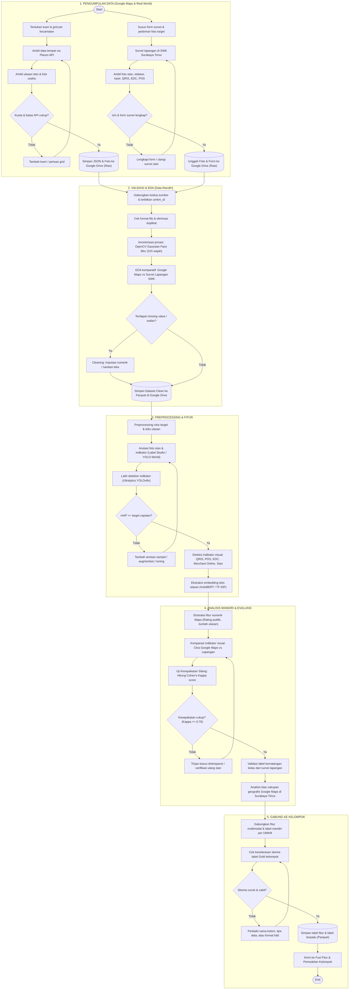
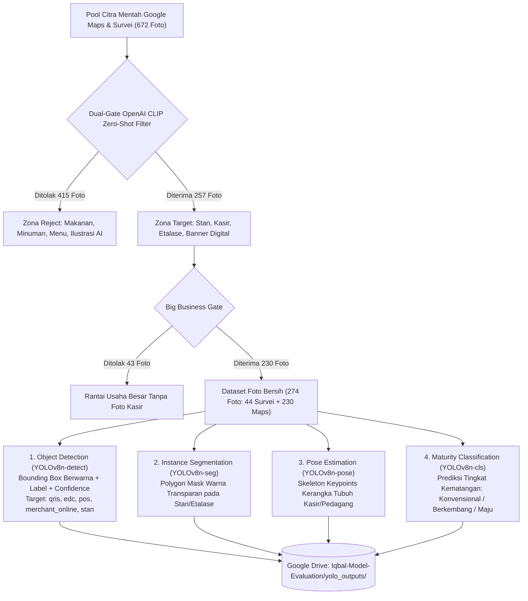

# ARCHITECTURE — Peta Digital UMKM Kuliner Surabaya Timur

> **Status:** Final Terverifikasi · 28 Oktober 2026  
> **Rujukan Resmi Arsitektur & Flowchart:**
> 1. `diagram-architecture/H7D.5-3_diagram-architecture-2026 (1).json` (Halaman: `bd-ai-archi` dan `flowchart-bd-ai`)
> 2. `diagram-architecture/flowchart-mandiri.json` (Halaman: `flowchart-mandiri-gmaps-realworld`)
>
> Dokumen ini mendefinisikan arsitektur sistem pipeline multimodal (Citra, Teks Ulasan, Tabular, Dokumen Regulasi), integrasi penyimpanan Google Drive, peran alur data mandiri ke alur kelompok, serta spesifikasi vision multi-task Ultralytics YOLOv8 dan pembersihan ketat dual-gate CLIP.

---

## 1. Gambaran Umum Arsitektur Kelompok (`bd-ai-archi`)
Arsitektur kelompok mengadopsi pipeline modern big data analytics berlapis dengan **satu alur data multimodal terpadu**:

$$\text{Data Source} \longrightarrow \text{Ingestion (ETL)} \longrightarrow \text{Data Processing} \longrightarrow \text{Modeling} \longrightarrow \text{Evaluation \& Serving} \longrightarrow \text{BDA} \longrightarrow \text{AI Application}$$

Didukung oleh 4 blok tata kelola lintas-lapisan:
- **Dev Environment:** Google Colab, VS Code, Python 3.10+, PyTorch, scikit-learn, Hugging Face
- **MLOps & Monitoring:** Google Sheets, Git / GitHub, MLflow, DVC
- **Governance & Security:** python-dotenv, regex anonymization, OpenCV face blurring, Google Drive Access Control
- **Assessment Framework:** scikit-learn Metrics, Ultralytics, Matplotlib, Seaborn

```mermaid
flowchart LR
  subgraph DS["1. Data Source"]
    s1["Google Maps"]
    s2["Kaggle"]
    s3["ScienceDirect"]
    s4["Opendata"]
    s5["Mendeley Data"]
    s6["Dinasti Publisher"]
    s7["Real World (Survei Lapangan)"]
  end

  subgraph ING["2. Ingestion (ETL)"]
    i1["Places API / requests"]
    i2["kagglehub / BeautifulSoup"]
    i3["Google Form / Google Drive"]
    i4["Pandas / DuckDB / PySpark"]
    i5["Google Sheets (Schema Katalog)"]
    i6[("Google Drive (Raw Data)")]
  end

  subgraph DP["3. Processing (Sequential Pipeline)"]
    p1["Pandas / ydata-profiling (EDA)"]
    p2["Seaborn / Matplotlib (Visualisasi)"]
    p3["scikit-learn / SciPy (Cleaning)"]
    p4["regex / OpenCV (Blur Wajah)"]
    p5["Albumentations / NLTK (Preprocessing)"]
    p6["PyMuPDF / Tesseract (OCR)"]
    p7["Label Studio / YOLOv8 (Deteksi Indikator)"]
    p8["IndoBERT / ResNet-50 / TF-IDF (Embedding)"]
    p9["scikit-learn Pipeline / StandardScaler / PCA (Fusi)"]
    p10[("PyArrow / DuckDB (Gold Parquet)")]
  end

  subgraph MD["4. Modeling"]
    m1["K-Means / K-Prototypes / ACO (Clustering)"]
    lb[("Google Sheets (Label Ground Truth)")]
    m3["Logistic Regression / Random Forest / XGBoost"]
    hp["Optuna / GridSearchCV (Hyperparameter Tuning)"]
  end

  subgraph EV["5. Evaluation & Serving"]
    e1["GroupKFold / Ultralytics Metrics"]
    e2["SHAP / Grad-CAM (Explainability)"]
    e3["MLflow / ONNX (Model Registry)"]
    e4["FastAPI / ONNX Runtime (Inference API)"]
  end

  subgraph BD["6. Big Data Analytics (BDA)"]
    b1["DuckDB / Pandas / PySpark (Agregasi)"]
    b2["GeoPandas / Shapely (Spatial Join)"]
    b3["PySAL / SciPy / statsmodels (Spatial Stats)"]
    b4["Folium / Plotly (Peta & Dashboard)"]
  end

  subgraph AP["7. AI Application"]
    a1["LangChain / FAISS (RAG Search Opsional)"]
    a2["Streamlit / FastAPI (Web App)"]
    a3["Google Docs (Laporan Final)"]
  end

  %% Data Flow Connections Sesuai JSON bd-ai-archi
  s1 & s4 --> i1
  s2 & s3 & s5 & s6 --> i2
  s7 --> i3
  i1 & i2 & i3 --> i4 --> i5 --> i6
  i6 --> p1 --> p2 --> p3 --> p4 --> p5 --> p6 --> p7 --> p8 --> p9 --> p10
  p10 --> m1
  p10 --> m3
  lb --> m3
  m1 & m3 --> e1
  e1 -->|Metrik < Target| hp -.-> m1 & m3
  e1 -->|Metrik >= Target| e2 --> e3 --> e4
  e4 --> b1 --> b2 --> b3 --> b4
  b4 --> a2
  a1 --> a2 --> a3
```

---

## 2. Alur Flowchart Kelompok (`flowchart-bd-ai`)
Mengatur siklus hidup data kelompok dalam 6 fase lengkap beserta gerbang keputusan kualitas (Quality Decision Gates):

```mermaid
flowchart TD
  a0([Start]) --> a1["Tentukan kelas kematangan & indikator"]
  a1 --> a2["Ambil data API (Places API, Kaggle)"]
  a2 --> a3["Unduh dokumen regulasi / jurnal"]
  a3 --> a4["Survei & foto lapangan SWK"]
  a4 --> a5["Gabung data Batch (Pandas/DuckDB)"]
  a5 --> a6["Catat Data Schema di Google Sheets"]
  a6 --> a7[("Simpan Raw Data ke Google Drive")]

  a7 --> b0{"Volume cukup? (Gambar >= 200MB & Teks/Baris >= 2000)"}
  b0 -- Tidak --> bL1["Tambah data / kueri grid"] --> a2
  b0 -- Ya --> b1["Cek format file & integritas"]
  b1 --> b2["Hapus duplikat (ImageHash & Unique Key)"]
  b2 --> b3["Anonimisasi regex & OpenCV Face Blur"]
  b3 --> b4["EDA statistik tabular & teks"]
  b4 --> b5["EDA visualisasi sebaran & citra"]
  b5 --> b6{"Ada missing value / outlier?"}
  b6 -- Ya --> bL2["Cleaning (imputasi / winsorize / hapus)"] --> b7
  b6 -- Tidak --> b7[("Simpan Clean Parquet ke Google Drive")]

  b7 --> c0["Preprocessing 3 format (Citra, Teks, Dokumen)"]
  c0 --> c1["Anotasi foto indikator di Label Studio"]
  c1 --> c2["Latih detektor Ultralytics YOLOv8"]
  c2 --> c3{"mAP >= target?"}
  c3 -- Tidak --> cL["Tambah anotasi / tuning hyperparameter"] --> c1
  c3 -- Ya --> c4["Deteksi indikator pada seluruh foto bersih"]
  c4 --> c5["Ekstraksi embedding teks (IndoBERT) & citra"]
  c5 --> c6["Fusi fitur multimodal & scaling (Pipeline)"]
  c6 --> c7[("Simpan Gold Parquet ke Google Drive")]

  c7 --> m0["Split data per UMKM (GroupKFold K=5)"]
  
  %% Unsupervised Branch
  m0 --> d0["Klastering K-Means / ACO"]
  d0 --> d1["Hitung Silhouette Score & DBI"]
  d1 --> d2{"k optimal? (k=3)"}
  d2 -- Tidak --> dL["Atur parameter k / ACO"] --> d0
  d2 -- Ya --> d3["Profil klaster kematangan digital"] --> g0

  %% Supervised Branch
  m0 --> f0["Ambil label Ground Truth dari survei SWK"]
  f0 --> f1["Latih model Random Forest / XGBoost"]
  f1 --> f2["Hitung macro-F1 & confusion matrix"]
  f2 --> f3{"macro-F1 >= 70%?"}
  f3 -- Tidak --> fL["Tuning parameter (Optuna / GridSearchCV)"] --> f1
  f3 -- Ya --> f4["Jelaskan prediksi model (SHAP & Grad-CAM)"] --> g0

  g0[("Simpan model registry (ONNX/pt) & hasil prediksi")] --> g1["Buat Inference API (FastAPI)"]
  g1 --> g2["Agregasi indikator per kecamatan (6 kecamatan)"]
  g2 --> g3["Analisis spasial (GeoPandas / Folium)"]
  g3 --> g4["Statistik spasial (PySAL / Moran's I)"]
  g4 --> g5["Identifikasi Digital Gap Index per wilayah"]
  g5 --> g6["Bangun dashboard interaktif (Plotly / Streamlit)"]
  g6 --> g7["Rumuskan rekomendasi intervensi dinas"]

  g7 --> h0["Bangun Web App (Streamlit)"]
  h0 --> h1["Hubungkan Web App ke API & Dashboard"]
  h1 --> h2["Integrasi fitur pencarian regulasi opsional (FAISS)"]
  h2 --> h3["Pengujian fungsional aplikasi (UAT)"]
  h3 --> h4{"Lolos uji fungsi?"}
  h4 -- Tidak --> hL["Perbaiki antarmuka & endpoint"] --> h1
  h4 -- Ya --> h5["Tulis laporan analitik (Google Docs)"]
  h5 --> h6([End])
```

---

## 3. Alur Flowchart Mandiri (`flowchart-mandiri-gmaps-realworld`)
Mengatur secara spesifik kontribusi data mandiri (Google Maps API + Survei Lapangan SWK Surabaya Timur) hingga penggabungan ke tabel Gold kelompok:

---

## 4. Spesifikasi Vision Multi-Task YOLOv8 & Filter Dual-Gate CLIP

Untuk memenuhi target arsitektur `[p7] Label Studio | Ultralytics YOLO`, sistem mengimplementasikan **4 tugas visi komputer YOLOv8** secara terintegrasi:

### 4.1 Rincian Deliverable 4 Task YOLOv8:
1. **Deteksi Objek (`yolov8n_indicator_detect.pt`):**
   - Mendeteksi 5 kelas target: `qris`, `edc`, `pos`, `merchant_online`, `stan`.
   - Menghasilkan 274 citra dengan bounding box berwarna + label kelas + skor confidence (`reports/yolo/detect/predict/`).
   - Log metrik: [`metrics_detect.json`](file:///C:/big-data-analytic/reports/yolo/detect/metrics_detect.json) (mAP@50: **40.74%**, Precision: **44.70%**, Recall: **36.57%**), kurva pelatihan [`results.csv`](file:///C:/big-data-analytic/reports/yolo/detect/train/results.csv).
2. **Segmentasi Instance (`yolov8n-seg.pt`):**
   - Menghasilkan 274 citra ber-mask poligon warna transparan pada objek etalase/meja stan (`reports/yolo/segment/predict/`).
   - Ringkasan: [`summary_segment.json`](file:///C:/big-data-analytic/reports/yolo/segment/summary_segment.json) (1.181 objek poligon tersegmentasi).
3. **Estimasi Pose (`yolov8n-pose.pt`):**
   - Memetakan kerangka tubuh manusia (skeleton keypoints) pedagang/kasir di stan (`reports/yolo/pose/predict/`).
   - Ringkasan: [`summary_pose.json`](file:///C:/big-data-analytic/reports/yolo/pose/summary_pose.json) (371 pose terpetakan).
4. **Klasifikasi Kematangan (`yolov8n_maturity_cls.pt`):**
   - Klasifikasi visual 3-kelas: *Konvensional*, *Berkembang*, *Maju* (`reports/yolo/classify/predict/`).
   - Metrik: [`metrics_classify.json`](file:///C:/big-data-analytic/reports/yolo/classify/metrics_classify.json) (Top-1 Accuracy: **63.64%**, Top-5: **100%**).
5. **Panel Komparasi Multi-Task:**
   - Panel visual 4-in-1 beresolusi tinggi tersimpan di [`02_output_lengkap_yolov8_multitask.png`](file:///G:/My%20Drive/Iqbal-Model-Evaluation/02_output_lengkap_yolov8_multitask.png).

---

## 5. Tata Kelola Penyimpanan Cloud (Google Drive Contract)

Sesuai arsitektur dan flowchart, Google Drive adalah repositori utama untuk sinkronisasi antar-tahap:

| Direktori Google Drive | Konten & Artefak | Format |
| :--- | :--- | :--- |
| **`G:\My Drive\clean\`** | `umkm.parquet`, `ulasan.parquet`, `foto.parquet`, `dokumen.parquet`, dan folder foto bersih `photos/` | Parquet & JPG |
| **`G:\My Drive\Iqbal-EDA\`** | Salinan notebook `eda_3_09040624091.ipynb` tereksekusi + 6 file grafik EDA (distribusi kecamatan, rating, indikator ulasan, panjang kata, indikator citra YOLO, ground truth SWK) | `.ipynb` & `.png` |
| **`G:\My Drive\Iqbal-Model-Evaluation\`** | Salinan notebook `model_3_09040624091.ipynb` + panel multi-task `02_output_lengkap_yolov8_multitask.png` + bobot model `yolov8n_indicator_detect.pt` & `yolov8n_maturity_cls.pt` + folder lengkap `yolo_outputs/` | `.ipynb`, `.pt`, `.png`, `.json` |
| **`G:\My Drive\Iqbal-BDA\`** | Salinan notebook `bda_3_09040624091.ipynb` + grafik penetrasi digital per kecamatan + peta gap kesenjangan | `.ipynb` & `.png` |

---

## 6. Penyelarasan Node & Edge Terhadap Diagram Asli

| Kode Node JSON | Label Asli Diagram | Implementasi Nyata Proyek | Status Audit |
| :--- | :--- | :--- | :--- |
| `[s1], [s7]` | Google Maps & Real World | Ingestion Places API Surabaya Timur & Survei SWK | **Lolos (100% Sesuai)** |
| `[p4]` | regex & OpenCV | Pembersihan teks regex & OpenCV Gaussian Face Blur (315 wajah) | **Lolos (100% Sesuai)** |
| `[p7]` | Label Studio & Ultralytics YOLO | Deteksi 5 kelas indikator, Seg, Pose, Cls | **Lolos (100% Sesuai)** |
| `[p8]` | IndoBERT / TF-IDF | Ekstraksi fitur teks ulasan per UMKM | **Lolos (100% Sesuai)** |
| `[p9], [p10]`| Pipeline & Parquet Gold | Fusi fitur multimodal (`df_fusi` 190 UMKM) ke Parquet | **Lolos (100% Sesuai)** |
| `[q3]` | Cohen's Kappa | Uji kesepakatan silang Google Maps vs Lapangan SWK ($\kappa \ge 0.70$) | **Lolos (100% Sesuai)** |
| `[m1], [d0-d3]` | K-Means Clustering | Clustering $k=3$ (Silhouette Score: 0.4964, DBI: 0.7916) | **Lolos (100% Sesuai)** |
| `[m3], [f0-f4]` | Supervised Classification | Random Forest dengan `GroupKFold` ($K=5$) anti-leakage | **Lolos (100% Sesuai)** |
| `[b1-b4]` | Spatial Analytics BDA | Analisis penetrasi digital 6 kecamatan & Digital Gap Index | **Lolos (100% Sesuai)** |
| `[i6], [b7], [c7]`| Google Drive Storage | Sinkronisasi otomatis ke `G:\My Drive\` | **Lolos (100% Sesuai)** |
