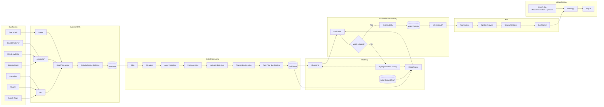
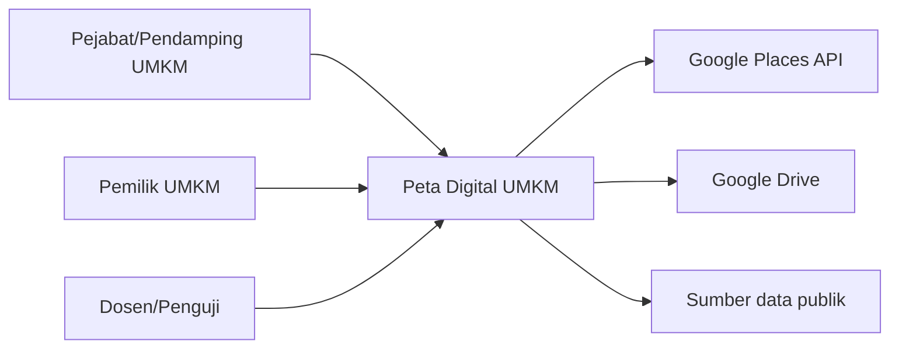
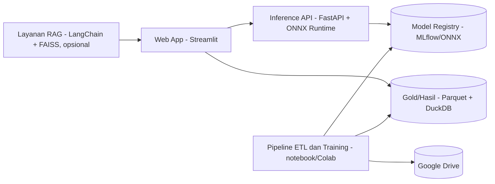

# ARCHITECTURE — Peta Digital UMKM Kuliner Surabaya Timur

> Status: Draft 0.1 · 26 Oktober 2026 · Sumber: file diagram `H7D_5-3_diagram-architecture-2026.json` (halaman `bd-ai-archi` dan `flowchart-bd-ai`). Halaman `app-ai-archi` (C4 aplikasi AI) dan `flowchart-app-ai` pada file itu masih kosong; bagian C4 di bawah adalah **usulan** untuk mengisinya.

## 1. Gambaran umum
Arsitektur berbentuk pipeline berlapis dengan **satu alur data multimodal** (gambar, teks/numerik, dokumen digabung, tidak dipisah per modalitas):

`DataSource → Ingestion (ETL) → Data Processing → Modeling → Evaluation & Serving → BDA → AI Application`

Didukung empat blok lintas-lapisan: **Dev Environment**, **MLOps & Monitoring**, **Governance & Security**, dan **Assessment Framework**.



## 2. Komponen
### 2.1 DataSource
| Sumber | Peran | Masuk lewat |
|---|---|---|
| Google Maps | Profil tempat, ulasan, foto | API |
| Kaggle | Dataset publik | API |
| Opendata | Data numerik/pemerintah | API |
| ScienceDirect, Mendeley Data, Dinasti Publisher | Jurnal/dataset pendukung | Application |
| Real World | Foto dan data lapangan | Survei |

### 2.2 Ingestion (ETL)
| Node | Teknologi | Fungsi |
|---|---|---|
| API | requests, Places API, kagglehub | Ambil data via API resmi |
| Application | requests, BeautifulSoup | Unduh dokumen/dataset |
| Survei | Manual Foto, Drive Upload | Unggah data lapangan |
| Batch/Streaming | Pandas, DuckDB, PySpark | Gabung sumber (batch; streaming opsional) |
| Data Collection Schema | Google Sheets | Katalog sumber dan metadata |
| Raw Data | Google Drive | Zona Raw immutable; target gambar ≥ 200 MB, teks/numerik ≥ 2.000 baris |

### 2.3 Data Processing (urut)
| # | Node | Teknologi |
|---|---|---|
| 1 | EDA | Pandas, ydata-profiling, Seaborn |
| 2 | Data Cleaning | scikit-learn, SciPy |
| 3 | Anonymization | regex, OpenCV (blur wajah) |
| 4 | Preprocessing | OpenCV, Albumentations, PyMuPDF, Tesseract OCR, NLTK |
| 5 | Indicator Detection | Label Studio, Ultralytics YOLO |
| 6 | Feature Engineering | IndoBERT, ResNet-50, TF-IDF |
| 7 | Fusi Fitur & Scaling | scikit-learn Pipeline, StandardScaler, PCA |
| 8 | Gold Data | Parquet, PyArrow, DuckDB |

### 2.4 Modeling
| Node | Teknologi | Catatan |
|---|---|---|
| Clustering | K-Means, K-Prototypes, ACO | Eksploratif/validasi; bukan sumber label |
| Label Ground Truth | Google Sheets (survei lapangan) | Sumber label kelas |
| Classification | Logistic Regression, Random Forest, XGBoost | Model utama 3 kelas |
| Hyperparameter Tuning | Optuna, GridSearchCV | Dipicu "Metrik ≥ target? = No" |

### 2.5 Evaluation & Serving
| Node | Teknologi |
|---|---|
| Evaluation | Silhouette, DBI, macro-F1, mAP, GroupKFold |
| Metrik ≥ target? | Gerbang keputusan (Yes → Explainability; No → Tuning) |
| Explainability | SHAP, Grad-CAM |
| Model Registry | MLflow, ONNX |
| Inference API | FastAPI, ONNX Runtime |

### 2.6 BDA dan AI Application
| Node | Teknologi |
|---|---|
| Aggregation | DuckDB, Pandas, PySpark |
| Spatial Analysis | GeoPandas, Folium |
| Spatial Statistics | PySAL, SciPy, statsmodels |
| Dashboard | Plotly, Streamlit |
| Search & Recommendation (opsional) | LangChain, FAISS |
| Web App | Streamlit, FastAPI |
| Report | Google Docs |

### 2.7 Blok lintas-lapisan
| Blok | Isi |
|---|---|
| Dev Environment | Google Colab, VS Code, Python 3.10+, PyTorch, scikit-learn, Hugging Face |
| MLOps & Monitoring | Google Sheets, Git/GitHub, MLflow, DVC (opsional) |
| Governance & Security | python-dotenv, regex anonimisasi, OpenCV blur wajah, Google Drive Access Control |
| Assessment Framework | scikit-learn Metrics, Ultralytics (mAP), Matplotlib, Seaborn |

## 3. Aliran data (edge pada diagram)
1. s1, s2, s4 → API; s3, s5, s6 → Application; s7 → Survei.
2. API, Application, Survei → Batch/Streaming → Data Collection Schema → Raw Data.
3. Raw Data → EDA → Cleaning → Anonymization → Preprocessing → Indicator Detection → Feature Engineering → Fusi Fitur & Scaling → Gold Data.
4. Gold Data → Clustering dan Classification; Label Ground Truth → Classification.
5. Clustering dan Classification → Evaluation → "Metrik ≥ target?".
6. Yes → Explainability → Model Registry → Inference API → Aggregation → Spatial Analysis → Spatial Statistics → Dashboard → Web App → Report.
7. No → Hyperparameter Tuning → kembali ke Clustering dan Classification.
8. Search & Recommendation (opsional) → Web App.

## 4. Zona data dan kontrak
| Zona | Lokasi | Format | Aturan |
|---|---|---|---|
| Raw | Google Drive `raw/` | JSON, CSV, JPG, PDF | Immutable; tidak ada transformasi |
| Clean | `clean/` | Parquet | Sudah dianonimkan dan divalidasi |
| Gold | `gold/` | Parquet | Satu baris per UMKM; fitur terskala; kolom `split_fold` |
| Models | `models/` / MLflow | `.onnx`, `.pkl` | Bersama metrik dan versi data |
| Reports | `reports/` | PNG, HTML, MD | Bukti untuk laporan |

Tabel inti (lihat `REQUIREMENTS.md` §3.2): `umkm`, `ulasan`, `foto`, `anotasi`, `dokumen`, `label`, `gold_fitur`. Kunci gabung: `umkm_id`.

## 5. Antarmuka layanan **[USULAN]**
| Endpoint | Metode | Fungsi |
|---|---|---|
| `/v1/health` | GET | Cek layanan |
| `/v1/classify` | POST | Masukan: foto (opsional, multi), teks (opsional). Keluaran: kelas, probabilitas, indikator terdeteksi, penjelasan singkat |
| `/v1/detect` | POST | Deteksi indikator pada foto (bbox + skor) |
| `/v1/map/summary` | GET | Agregat per kecamatan dan kelas |
| `/v1/regulation/search` | POST | (Opsional) pencarian regulasi/insentif |

Respons `/v1/classify` (contoh):
```json
{
  "kelas": "Berkembang",
  "probabilitas": {"Konvensional": 0.12, "Berkembang": 0.66, "Maju": 0.22},
  "indikator": {"qris": true, "pos": false, "edc": false, "merchant_online": false},
  "penjelasan": ["QRIS terdeteksi pada foto", "Tidak ada POS/EDC terdeteksi"],
  "versi_model": "v0.1"
}
```

## 6. C4 Model aplikasi AI **[USULAN untuk halaman `app-ai-archi`]**
### Level 1 — Konteks

### Level 2 — Kontainer

### Level 3 — Komponen (Inference API)
Router (`/v1/*`) → validasi masukan (Pydantic) → praproses gambar/teks → detektor indikator → fusi fitur → klasifikator → penjelasan → respons.

## 7. Keputusan arsitektur (ringkas)
| Keputusan | Alasan | Konsekuensi |
|---|---|---|
| Satu alur multimodal (bukan jalur per modalitas) | Satu model akhir per UMKM; fusi di tabel Gold | Perlu penanganan modalitas hilang |
| Label dari survei, klaster hanya eksploratif | Mencegah pelabelan melingkar | Survei lapangan wajib memadai |
| GroupKFold per UMKM | Foto/ulasan satu usaha tidak bocor | Pembagian data lebih kecil per fold |
| Pandas + DuckDB sebagai inti, PySpark untuk demonstrasi | Data berukuran ribuan baris; PySpark berat | Streaming bersifat opsional |
| Parquet/PyArrow untuk Clean dan Gold | Kolumnar, kompak, tipe terjaga | Tidak langsung terbuka di Excel |
| YOLO untuk indikator | Cepat, tooling lengkap | Butuh anotasi bbox; lisensi AGPL-3.0 |
| ONNX Runtime untuk serving | Inferensi ringan dan portabel | Konversi perlu diuji |
| Streamlit + FastAPI | Cepat dibangun, mudah didemokan | UI kustom terbatas |

## 8. Kualitas dan keamanan
- **Privasi:** anonimisasi sebelum Clean; blur wajah; dashboard hanya agregat.
- **Secret:** `.env`; akses Drive berbasis peran.
- **Reproduksibilitas:** versi pustaka dan seed; eksperimen tercatat di MLflow/tabel.
- **Pemantauan:** log metrik dan versi model; cek drift data baru (opsional).
- **Penilaian:** macro-F1 ≥ 70%, mAP per kelas, Silhouette/DBI dilaporkan; baseline wajib disertakan.

## 9. Keterbatasan dan risiko arsitektur
- API Google Places membatasi ulasan (sekitar 5/tempat) dan hasil per kueri.
- Bias seleksi: UMKM tanpa jejak daring tampak Konvensional.
- Ukuran sampel kecil untuk model gambar dan kelas Maju.
- PySpark tidak diperlukan untuk skala data ini; kehadirannya bersifat demonstratif.
- Kuota GPU Colab tidak pasti.

## 10. Pengembangan lanjutan
Klasifikasi ordinal (Konvensional < Berkembang < Maju); fusi late (stacking per modalitas); pemantauan drift; perluasan ke wilayah lain; sumber data tambahan (menu digital, platform pesan-antar).
