# WORKFLOW — Peta Digital UMKM Kuliner Surabaya Timur

> Status: Draft 0.1 · 26 Oktober 2026 · Bagian A: alur data (dari `flowchart-bd-ai`). Bagian B: cara kerja tim. Bagian C: aturan keputusan dan kualitas.

## A. Alur data (6 fase, 1 alur multimodal)

```mermaid
flowchart TD
  S([Start]) --> P1[Tentukan kelas dan indikator]
  P1 --> I[Ingestion: API, dokumen, survei, real world]
  I --> RAW[(Raw Data - Google Drive)]
  RAW --> G1{Volume cukup?}
  G1 -- Tidak --> I
  G1 -- Ya --> V[Validasi, hapus duplikat, anonimisasi]
  V --> EDA[EDA statistik dan visual]
  EDA --> G2{Missing / outlier?}
  G2 -- Ya --> CL[Cleaning] --> CLEAN
  G2 -- Tidak --> CLEAN[(Clean - Parquet)]
  CLEAN --> PRE[Preprocessing 3 format]
  PRE --> ANN[Anotasi foto] --> YOLO[Latih detektor YOLO]
  YOLO --> G3{mAP ≥ target?}
  G3 -- Tidak --> ANN
  G3 -- Ya --> FE[Deteksi indikator + embedding + fusi fitur]
  FE --> GOLD[(Gold - Parquet)]
  GOLD --> SP[Split per UMKM]
  SP --> K[Klaster] --> KD{k optimal?}
  KD -- Tidak --> K
  SP --> C[Klasifikasi] --> CD{macro-F1 ≥ 70%?}
  CD -- Tidak --> C
  KD -- Ya --> REG
  CD -- Ya --> XAI[SHAP / Grad-CAM] --> REG[(Model Registry)]
  REG --> API[Inference API]
  API --> BDA[Agregasi, spasial, statistik, gap]
  BDA --> DASH[Dashboard] --> APP[Web App]
  APP --> T{Lolos uji?}
  T -- Tidak --> APP
  T -- Ya --> R[Laporan] --> E([End])
```

### Fase, masukan, keluaran, dan gerbang
| # | Fase | Masukan | Keluaran | Gerbang (keputusan) |
|---|---|---|---|---|
| 1 | Ingestion (ETL) | Sumber: Google Maps, Kaggle, Opendata, Mendeley, jurnal, survei, real world | Raw Data + Data Collection Schema | Volume cukup? (gambar ≥ 200 MB, teks/numerik ≥ 2.000 baris); Tidak → tambah data |
| 2 | Validasi dan EDA | Raw Data | Clean (Parquet), laporan EDA | Missing/outlier? Ya → cleaning |
| 3 | Preprocessing dan fitur | Clean | Anotasi, detektor, fitur Gold | mAP ≥ target? Tidak → tambah anotasi/tuning |
| 4 | Modeling dan evaluasi | Gold + label survei | Model klaster dan klasifikasi, metrik, penjelasan | k optimal?; macro-F1 ≥ 70%? Tidak → tuning |
| 5 | Serving dan BDA | Model terdaftar, hasil prediksi | Inference API, agregasi, peta, statistik spasial, gap, dashboard | — |
| 6 | AI Application | API + dashboard | Web App, laporan | Lolos uji? Tidak → perbaiki |

### Aturan keputusan
- **Volume:** tidak boleh lanjut sebelum gerbang volume terpenuhi; tetap catat jumlah aktual di Sheet.
- **Missing/outlier:** catat metode (imputasi/hapus/winsorize) dan alasannya; jangan membuang UMKM yang jarang tanpa pencatatan.
- **mAP:** target ditetapkan setelah baseline; evaluasi pada foto dari UMKM yang tidak ada di data latih.
- **Klaster (k optimal?):** pilih k berdasarkan Silhouette, DBI, ukuran klaster, dan keselarasan domain (3 kelas); laporkan jika Silhouette tinggi tetapi satu klaster sangat kecil.
- **Klasifikasi:** macro-F1 ≥ 70% pada data uji per UMKM; bandingkan dengan baseline; label hanya dari survei.
- **Lolos uji:** daftar uji fungsi disepakati di awal (unggah foto, filter peta, respons API, ekspor).

## B. Cara kerja tim
### B.1 Peran **[USULAN]**
| Peran | Tanggung jawab |
|---|---|
| Koordinator | Jadwal, Sheet monitoring, integrasi, penghubung dosen |
| Data engineer | Ingestion, Data Collection Schema, Drive, ETL |
| Analis data | Validasi, EDA, cleaning, BDA, dashboard |
| Vision / NLP engineer | Anotasi, YOLO, embedding, preprocessing |
| ML engineer | Modeling, evaluasi, tuning, registry, Inference API |
| App dan dokumentasi | Web App, diagram, laporan |
Satu anggota boleh memegang lebih dari satu peran; pastikan setiap fase punya PJ.

### B.2 Git dan notebook
- Cabang: `main` (stabil), `dev` (integrasi), `fitur/<fase>-<nama>`.
- Alur: buat cabang → commit kecil → pull request ke `dev` → minimal 1 reviewer → merge.
- Pesan commit: `fase: ringkasan` (mis. `eda: tambah profil gambar`).
- Notebook bernomor: `01_ingestion`, `02_eda`, `03_preprocessing`, `04_features`, `05_models`, `06_evaluation`, `07_bda`. Bersihkan output sebelum commit (nbstripout/jupytext).
- Logika yang dipakai ulang dipindah ke `src/umkm/` dan dipanggil dari notebook.
- Jangan commit: data mentah/olahan, model besar, `.env`, kunci API, foto yang belum dianonimkan.

### B.3 Penamaan dan penyimpanan data
- Raw: `raw/<sumber>/<tanggal>/...` (tidak diubah). Foto lapangan: `raw/survei/<kecamatan>/<nama_tempat>/<file>`.
- Clean: `clean/<tabel>.parquet`. Gold: `gold/fitur_umkm.parquet`.
- Model: `models/<nama>/<versi>/` beserta metrik dan versi data.
- Setiap file hasil olahan mencantumkan versi data dan seed.

### B.4 Ritme kerja **[USULAN]**
- Rapat singkat mingguan: status per fase, hambatan, keputusan gerbang.
- Perbarui Sheet monitoring setelah setiap tugas selesai.
- Review lintas anggota sebelum merge dan sebelum mengunci diagram atau laporan.

## C. Kualitas dan bukti
- **Reproduksibilitas:** jalankan ulang notebook dari Raw sebelum klaim hasil; versi pustaka dan seed dicatat.
- **Anti-leakage:** split per UMKM; scaler/encoder dipasang hanya di data latih (gunakan Pipeline); label bukan turunan fitur.
- **Bukti:** simpan gambar grafik, confusion matrix, contoh deteksi, dan Grad-CAM di folder `reports/` untuk laporan.
- **Etika dan privasi:** tinjau anonimisasi pada sampel acak sebelum data masuk Clean.
- **Konsistensi diagram:** setiap perubahan arsitektur atau alur memperbarui draw.io, `ARCHITECTURE.md`, dan dokumen ini.

## D. Peta ke tugas kelompok (panduan)
1. Arsitektur BDA kelompok dan mandiri (draw.io hlm. 1).
2. Flowchart BDA kelompok dan mandiri (draw.io hlm. 2).
3. Arsitektur aplikasi AI (C4 Model, hlm. 3).
4. Flowchart aplikasi AI (hlm. 4).
5. Rencana dan pemantauan di Google Sheet.
6. Laporan di Google Docs dan kode di Google Colab.
