# WORKFLOW — Peta Digital UMKM Kuliner Surabaya Timur

> **Status:** Final Terverifikasi · 4 November 2026  
> **Rujukan Resmi Arsitektur & Flowchart Mandiri:**
> 1. *Arsitektur Big Data & AI - Peta Digital UMKM Kuliner Surabaya Timur* (`mxGraphModel` Arsitektur)
> 2. *Flowchart Alur Pengerjaan Mandiri 6 Tahap* (`mxGraphModel` `B1`–`B6`)

---

## Bagian 1: Flowchart Alur Pengerjaan Mandiri (`B1` – `B6`)

Diagram berikut memetakan secara persis 6 tahap pengerjaan mandiri mulai dari **1. INGESTION (ETL)** hingga **6. AI APPLICATION** sesuai struktur node dan edge pada `mxGraphModel`:

```mermaid
flowchart TD
  subgraph B1["1. INGESTION (ETL)"]
    direction LR
    n1(["<b>n1: Start</b>"]) --> n2["<b>n2: Tentukan kelas<br/>& indikator</b>"]
    n2 --> n3["<b>n3: Ambil data<br/>Google Maps (API)</b>"]
    n3 --> n4["<b>n4: Survei & foto<br/>lapangan (SWK)</b>"]
    n4 --> n5["<b>n5: Catat label<br/>survei (Sheets)</b>"]
    n5 --> n6["<b>n6: Gabung data<br/>(Batch)</b>"]
    n6 --> n7["<b>n7: Catat<br/>Data Schema</b>"]
    n7 --> n8[("<b>n8: Simpan<br/>Raw Data</b>")]
  end

  subgraph B2["2. VALIDASI & EDA"]
    direction RL
    vol{"<b>vol: Volume<br/>cukup?</b>"}
    tambah["<b>tambah: Tambah data ≥200 MB<br/>& ≥2.000 baris</b>"]
    cek["<b>cek: Cek format<br/>file</b>"]
    dup["<b>dup: Hapus<br/>duplikat</b>"]
    anon["<b>anon: Anonimisasi<br/>(blur wajah, sensor PII)</b>"]
    eda1["<b>eda1: EDA statistik<br/>(rating, ulasan)</b>"]
    eda2["<b>eda2: EDA visualisasi<br/>(foto Maps vs Real)</b>"]
    miss{"<b>miss: Ada missing /<br/>outlier?</b>"}
    clean["<b>clean: Cleaning<br/>(imputasi/hapus)</b>"]
    simpan[("<b>simpan: Simpan Clean<br/>(Parquet)</b>")]

    vol -- "Ya (vy)" --> cek
    vol -- "Tidak (vn)" --> tambah
    cek --> dup --> anon --> eda1 --> eda2 --> miss
    miss -- "Ya (my)" --> clean --> simpan
    miss -- "Tidak (mn)" --> simpan
  end

  subgraph B3["3. PREPROCESSING & FITUR"]
    direction LR
    pre["<b>pre: Preprocessing<br/>teks & foto</b>"] --> ann["<b>ann: Anotasi foto<br/>(Label Studio)</b>"]
    ann --> latih["<b>latih: Latih deteksi<br/>(YOLO)</b>"]
    latih --> dmap{"<b>dmap: mAP ≥<br/>target?</b>"}
    tun["<b>tun: Tambah anotasi<br/>/ tuning</b>"]
    det["<b>det: Deteksi indikator<br/>pada semua foto</b>"]
    emb["<b>emb: Embedding teks<br/>& gambar</b>"]
    fusi["<b>fusi: Fusi fitur<br/>& scaling</b>"]
    fs[("<b>fs: Simpan Feature Store<br/>(Parquet)</b>")]

    dmap -- "Ya (dy)" --> det --> emb --> fusi --> fs
    dmap -- "Tidak (dn)" --> tun
    tun -. "tla" .-> ann
  end

  subgraph B4["4. MODELING & EVALUASI"]
    direction RL
    split["<b>split: Split data<br/>per UMKM</b>"]

    %% Cabang Klastering (Unsupervised)
    kl["<b>kl: Klaster<br/>K-Means / ACO</b>"]
    sil["<b>sil: Hitung<br/>Silhouette</b>"]
    dk{"<b>dk: k optimal?</b>"}
    atk["<b>atk: Atur k / ACO</b>"]
    prof["<b>prof: Profil<br/>klaster</b>"]

    %% Cabang Klasifikasi (Supervised)
    lab["<b>lab: Ambil label<br/>survei</b>"]
    rf["<b>rf: Latih model<br/>RF / XGBoost</b>"]
    f1["<b>f1: Hitung macro-F1<br/>& Kappa</b>"]
    df{"<b>df: F1 ≥ 70%?</b>"}
    par["<b>par: Atur<br/>parameter</b>"]
    shap["<b>shap: Jelaskan model<br/>(SHAP)</b>"]

    split --> kl --> sil --> dk
    dk -- "Ya (kyes)" --> prof
    dk -- "Tidak (kno)" --> atk
    atk -. "kloop" .-> kl

    split --> lab --> rf --> f1 --> df
    df -- "Ya (lyes)" --> shap
    df -- "Tidak (lno)" --> par
    par -. "lloop" .-> rf
  end

  subgraph B5["5. SERVING & BDA"]
    direction LR
    s1["<b>s1: Simpan model<br/>& hasil (MLflow)</b>"] --> s2["<b>s2: Buat<br/>Inference API</b>"]
    s2 --> s3["<b>s3: Agregasi per<br/>kecamatan</b>"]
    s3 --> s4["<b>s4: Analisis spasial<br/>(peta)</b>"]
    s4 --> s5["<b>s5: Statistik<br/>spasial</b>"]
    s5 --> s6["<b>s6: Cari gap<br/>per wilayah</b>"]
    s6 --> s7["<b>s7: Buat<br/>dashboard</b>"]
    s7 --> s8["<b>s8: Rekomendasi<br/>intervensi</b>"]
  end

  subgraph B6["6. AI APPLICATION"]
    direction RL
    web["<b>web: Bangun<br/>web app</b>"] --> hub["<b>hub: Hubungkan API<br/>& dashboard</b>"]
    hub --> fit["<b>fit: Fitur cari UMKM<br/>(opsional)</b>"]
    fit --> uji["<b>uji: Uji<br/>aplikasi</b>"]
    uji --> ok{"<b>ok: Lolos uji?</b>"}
    per["<b>per: Perbaiki</b>"]
    lap["<b>lap: Tulis<br/>laporan</b>"]
    end_node(["<b>end: End</b>"])

    ok -- "Ya (oy)" --> lap --> end_node
    ok -- "Tidak (on)" --> per
    per -. "ploop" .-> hub
  end

  %% Koneksi Antar-Blok
  n8 -- "v0" --> vol
  tambah -. "tl" .-> n3
  simpan -- "s23" --> pre
  fs -- "s34" --> split
  prof -- "p5" --> s1
  shap -- "sh5" --> s1
  s8 -- "s56" --> web
```

---

## Bagian 2: Rincian Langkah Operasional Mandiri (`B1` – `B6`)

### 1. INGESTION (ETL) (`B1`)
| Kode Node | Nama Langkah | Detail Eksekusi & Alat |
| :--- | :--- | :--- |
| **`n1`** | **Start** | Inisialisasi proyek pemetaan kematangan digital UMKM kuliner di 6 kecamatan Surabaya Timur. |
| **`n2`** | **Tentukan kelas & indikator** | Menetapkan 3 kelas kematangan (*Konvensional*, *Berkembang*, *Maju*) dan indikator target (`QRIS`, `EDC`, `POS`, stiker merchant online). |
| **`n3`** | **Ambil data Google Maps (API)** | Mengambil profil lokasi, rating, teks ulasan, dan foto UMKM menggunakan Google Places API & REST HTTP (`e0`). |
| **`n4`** | **Survei & foto lapangan (SWK)** | Melakukan survei lapangan dan pengambilan foto stan, kasir, serta instrumen pembayaran di SWK Surabaya Timur (`s3`, `e3`). |
| **`n5`** | **Catat label survei (Sheets)** | Mencatat label ground truth hasil survei lapangan SWK ke dalam Google Sheets (`e3`, `e5`). |
| **`n6`** | **Gabung data (Batch)** | Menggabungkan batch data JSON & CSV dari Google Maps dan survei lapangan menggunakan Pandas & PySpark (`e4`). |
| **`n7`** | **Catat Data Schema** | Mendokumentasikan katalog dan skema data pada Google Sheet (`e5`). |
| **`n8`** | **Simpan Raw Data** | Menyimpan seluruh data mentah (`JSON`, `CSV`, `PDF`, `Foto`) ke Google Drive tier **Raw Data (`c0`)**. |

### 2. VALIDASI & EDA (`B2`)
| Kode Node | Nama Langkah | Detail Eksekusi & Alat |
| :--- | :--- | :--- |
| **`vol`** | **Volume cukup?** | Gerbang pemeriksaan: apakah volume foto $\ge 200\text{ MB}$ dan jumlah baris $\ge 2.000$? Jika **Tidak (`vn`)**, lanjut ke `tambah` ($\ge 200\text{ MB}$ & $\ge 2.000$ baris) lalu kembali ke `n3`. |
| **`cek`** | **Cek format file** | Memvalidasi integritas dan membaca/konversi format foto menggunakan Pillow (`p5`) serta dokumen PDF (`p1`). |
| **`dup`** | **Hapus duplikat** | Menghapus foto duplikat menggunakan OpenCV / perceptual hash (`p2`) dan deduplikasi entitas UMKM (`p4`). |
| **`anon`** | **Anonimisasi (blur wajah, sensor PII)** | Memburamkan wajah manusia dengan OpenCV (`p2`) dan menyensor PII pada teks ulasan dengan Regex & NLTK (`p0`). |
| **`eda1`** | **EDA statistik (rating, ulasan)** | Menyusun profil otomatis dengan `ydata-profiling` (`d0`) serta analisis sebaran rating & ulasan per wilayah dengan Seaborn & Matplotlib (`d1`). |
| **`eda2`** | **EDA visualisasi (foto Maps vs Real)** | Membandingkan karakteristik visual foto Google Maps vs *Real World* survei SWK menggunakan Matplotlib (`d2`). |
| **`miss`** | **Ada missing / outlier?** | Memeriksa nilai kosong dan outlier IQR (`p4`). Jika **Ya (`my`)**, jalankan **`clean` (Cleaning: imputasi/hapus)** sebelum ke `simpan`. |
| **`simpan`** | **Simpan Clean (Parquet)** | Menyimpan dataset bersih ke Google Drive tier **Processed Data (`c1`)** dalam format Parquet bersih. |

### 3. PREPROCESSING & FITUR (`B3`)
| Kode Node | Nama Langkah | Detail Eksekusi & Alat |
| :--- | :--- | :--- |
| **`pre`** | **Preprocessing teks & foto** | Tokenisasi/stopword removal teks (`p0`), *resize* OpenCV (`p2`), dan augmentasi gambar dengan Albumentations (`p3`). |
| **`ann`** | **Anotasi foto (Label Studio)** | Melakukan anotasi kotak batas (*bounding box*) objek `QRIS`, `EDC`, `POS`, dan stiker merchant menggunakan Label Studio (`f1`). |
| **`latih`** | **Latih deteksi (YOLO)** | Melatih model detektor objek menggunakan Ultralytics YOLO (`f1`, `l2`) di atas backend PyTorch (`l0`). |
| **`dmap`** | **mAP $\ge$ target?** | Evaluasi Ultralytics mAP (`me3`). Jika **Tidak (`dn`)**, jalankan **`tun` (Tambah anotasi / tuning)** lalu kembali ke `ann`. |
| **`det`** | **Deteksi indikator pada semua foto** | Menjalankan inferensi deteksi indikator pada seluruh foto bersih dan mengodekannya ke biner `0/1` (`f1`, `f3`). |
| **`emb`** | **Embedding teks & gambar** | Mengekstrak vektor teks ulasan dengan IndoBERT & TF-IDF (`f0`, `l1`), fitur visual merchant dengan ResNet-50 (`f2`), dan chunk dokumen dengan Sentence-Transformers (`f4`). |
| **`fusi`** | **Fusi fitur & scaling** | Menggabungkan seluruh fitur multimodal menggunakan `scikit-learn Pipeline` (`StandardScaler` & `PCA` `f5`). |
| **`fs`** | **Simpan Feature Store (Parquet)** | Menyimpan matriks fitur ke **Feature Store (`FS: fs0–fs3`)** di Google Drive dalam format Apache Parquet (PyArrow), NumPy (`.npy/.npz`), dan Pandas DataFrame. |

### 4. MODELING & EVALUASI (`B4`)
| Kode Node | Nama Langkah | Detail Eksekusi & Alat |
| :--- | :--- | :--- |
| **`split`** | **Split data per UMKM** | Membagi data berdasarkan `umkm_id` (`GroupKFold` $K=5$) untuk mencegah kebocoran data (*anti-leakage*) antara cabang klastering dan klasifikasi. |
| **`kl` $\rightarrow$ `sil` $\rightarrow$ `dk`** | **Klaster K-Means / ACO $\rightarrow$ Hitung Silhouette $\rightarrow$ k optimal?** | Melatih K-Means / K-Prototypes (`m0`) dengan optimasi centroid ACO NumPy (`m2`) dan menghitung Silhouette Score (`me1`). Jika belum optimal (`kno`), jalankan **`atk` (Atur k / ACO)** lalu ulangi `kl`. |
| **`prof`** | **Profil klaster** | Menyusun profil karakteristik tiap klaster kematangan dan memvisualisasikannya dengan PCA (`vz2`). |
| **`lab` $\rightarrow$ `rf` $\rightarrow$ `f1` $\rightarrow$ `df`** | **Ambil label survei $\rightarrow$ Latih model RF / XGBoost $\rightarrow$ Hitung macro-F1 & Kappa $\rightarrow$ F1 $\ge 70\%$?** | Mengambil label ground truth survei SWK, melatih Random Forest / Logistic Regression (`m0`) dan XGBoost (`m1`), serta menghitung `macro-F1` (`me0`) & `Cohen's Kappa` (`me2`). Jika F1 $< 70\%$ (`lno`), jalankan **`par` (Atur parameter)** lalu ulangi `rf`. |
| **`shap`** | **Jelaskan model (SHAP)** | Menganalisis pengaruh fitur menggunakan SHAP (`me4`) serta area fokus visual dengan Grad-CAM (`me5`). |

### 5. SERVING & BDA (`B5`)
| Kode Node | Nama Langkah | Detail Eksekusi & Alat |
| :--- | :--- | :--- |
| **`s1`** | **Simpan model & hasil (MLflow)** | Mencatat eksperimen dan membekukan model terbaik di MLflow Model Registry (`o0`, `rg0`) dalam format `.onnx` (`rg1`), `.joblib` (`m3`, `rg2`), dan `.pt` (`rg3`). |
| **`s2`** | **Buat Inference API** | Membangun endpoint prediksi menggunakan FastAPI (`in0`), ONNX Runtime (`in1`), scikit-learn Predict (`in2`), dan Ultralytics YOLO Predict (`in3`). |
| **`s3`** | **Agregasi per kecamatan** | Mengagregasi indikator dan tingkat kematangan digital per kecamatan di Surabaya Timur dengan Pandas & PySpark (`bd0`). |
| **`s4`** | **Analisis spasial (peta)** | Memetakan titik lokasi UMKM ke poligon kecamatan Surabaya Timur dengan GeoPandas & Shapely (`bd1`). |
| **`s5`** | **Statistik spasial** | Menghitung autokorelasi spasial dan mengevaluasi bias cakupan wilayah dengan PySAL, SciPy & statsmodels (`bd2`). |
| **`s6`** | **Cari gap per wilayah** | Menganalisis *gap* digitalisasi wilayah (*Digital Gap Index*) menggunakan Pandas (`bd3`). |
| **`s7`** | **Buat dashboard** | Membangun visualisasi peta interaktif 3 kelas dengan Folium & Plotly (`vz0`) serta grafik Seaborn & Matplotlib (`vz1`). |
| **`s8`** | **Rekomendasi intervensi** | Merumuskan prioritas rekomendasi intervensi per wilayah kecamatan dan sentra kuliner. |

### 6. AI APPLICATION (`B6`)
| Kode Node | Nama Langkah | Detail Eksekusi & Alat |
| :--- | :--- | :--- |
| **`web`** | **Bangun web app** | Membangun aplikasi web pengecekan status digital UMKM menggunakan Streamlit & FastAPI (`a0`). |
| **`hub`** | **Hubungkan API & dashboard** | Mengintegrasikan endpoint Inference API (`in0`) dan dashboard peta interaktif (`vz0`) ke dalam Web App. |
| **`fit`** | **Fitur cari UMKM (opsional)** | Menambahkan fitur pencarian UMKM & rekomendasi intervensi otomatis berbasis RAG dengan LangChain & FAISS (`a1`). |
| **`uji` $\rightarrow$ `ok`** | **Uji aplikasi $\rightarrow$ Lolos uji?** | Melakukan pengujian fungsional. Jika **Tidak (`on`)**, jalankan **`per` (Perbaiki)** lalu kembali ke `hub`. |
| **`lap` $\rightarrow$ `end`** | **Tulis laporan $\rightarrow$ End** | Menyusun laporan akhir & rekomendasi intervensi *E-Gov* di Google Docs (`a2`, `c2`) dan menyelesaikan alur kerja (`end`). |
