# WORKFLOW — Peta Digital UMKM Kuliner Surabaya Timur

> **Status:** Final Terverifikasi · 28 Oktober 2026  
> **Rujukan Resmi Alur & Flowchart:**
> 1. `diagram-architecture/H7D.5-3_diagram-architecture-2026 (1).json` (`flowchart-bd-ai` dan `bd-ai-archi`)
> 2. `diagram-architecture/flowchart-mandiri.json` (`flowchart-mandiri-gmaps-realworld`)

Dokumen ini memetakan alur kerja terpadu proyek, mencakup **Alur Data Kelompok (6 Fase)**, **Alur Data Mandiri (5 Tahap)**, serta **Aturan Gerbang Keputusan Kualitas (Decision Gates)**.

---

## Bagian 1: Alur Data Kelompok (6 Fase)

Sesuai halaman `flowchart-bd-ai`, alur data kelompok dirancang secara linear berurutan dengan satu alur multimodal dan loop perbaikan:

```mermaid
flowchart TD
  S([Start]) --> P1["1. INGESTION (ETL): Tentukan kelas, ambil data API, dokumen, survei SWK"]
  P1 --> RAW[("Simpan Raw Data ke Google Drive")]
  
  RAW --> G1{"Gerbang 1: Volume cukup?<br>(Gambar >= 200MB & Teks/Baris >= 2000)"}
  G1 -- Tidak --> P1
  G1 -- Ya --> P2["2. VALIDASI & EDA: Cek format, hapus duplikat, blur wajah OpenCV, EDA statistik & visual"]
  
  P2 --> G2{"Gerbang 2: Ada missing / outlier?"}
  G2 -- Ya --> CL["Cleaning: Imputasi / sanitasi / filter"] --> CLEAN
  G2 -- Tidak --> CLEAN[("Simpan Clean Parquet ke Google Drive")]
  
  CLEAN --> P3["3. PREPROCESSING & FITUR: Preprocessing 3 format, anotasi Label Studio, latih YOLOv8"]
  P3 --> G3{"Gerbang 3: mAP >= target capaian?"}
  G3 -- Tidak --> P3
  G3 -- Ya --> P3B["Deteksi indikator seluruh foto + embedding IndoBERT + fusi multimodal"]
  P3B --> GOLD[("Simpan Gold Parquet ke Google Drive")]
  
  GOLD --> P4["4. MODELING & EVALUASI: Split GroupKFold K=5 anti-leakage"]
  
  %% Unsupervised
  P4 --> K["Klastering K-Means (k=3) & Profil"]
  K --> G4A{"Gerbang 4A: k optimal & Silhouette memadai?"}
  G4A -- Tidak --> K
  G4A -- Ya --> REG[("Model Registry & Hasil Prediksi")]
  
  %% Supervised
  P4 --> C["Klasifikasi Random Forest (Label Survei SWK)"]
  C --> G4B{"Gerbang 4B: macro-F1 >= 70%?"}
  G4B -- Tidak --> C
  G4B -- Ya --> XAI["Explainability (SHAP & Grad-CAM)"] --> REG
  
  REG --> P5["5. SERVING & BDA: Inference API, agregasi 6 kecamatan, analisis spasial, Digital Gap Index"]
  P5 --> DASH["Dashboard Interaktif & Rekomendasi Kebijakan"]
  
  DASH --> P6["6. AI APPLICATION: Web App Streamlit terhubung API & Dashboard"]
  P6 --> G5{"Gerbang 5: Lolos uji fungsi (UAT)?"}
  G5 -- Tidak --> P6
  G5 -- Ya --> REP["Laporan Analitik Komprehensif (Google Docs)"] --> END([End])
```



---

## Bagian 2: Alur Data Mandiri (`flowchart-mandiri-gmaps-realworld`)

Alur mandiri berfokus pada pengumpulan data Google Maps API dan survei lapangan di Sentra Wisata Kuliner (SWK) Surabaya Timur hingga terintegrasi ke skema Gold kelompok:

```mermaid
flowchart TD
  subgraph T1["Tahap 1: Pengumpulan Data Mandiri"]
    S_M([Start]) --> M_API["Google Maps: Kueri & grid per kecamatan -> Places API -> Teks ulasan & foto"]
    S_M --> M_SRV["Survei Lapangan: Pedoman foto -> Survei SWK Surabaya Timur -> Foto kasir/etalase/QRIS/EDC/POS"]
    M_API --> M_G1{"Kuota & batas API cukup?"}
    M_G1 -- Tidak --> M_API
    M_G1 -- Ya --> RAW_M[("Simpan JSON & Foto Mentah ke Google Drive (Raw)")]
    M_SRV --> M_G2{"Izin & form survei lengkap?"}
    M_G2 -- Tidak --> M_SRV
    M_G2 -- Ya --> RAW_M
  end

  subgraph T2["Tahap 2: Validasi & EDA Data Mandiri"]
    RAW_M --> M_VAL["Gabungkan kedua sumber & terbitkan umkm_id konsisten"]
    M_VAL --> M_DEDUP["Cek format file & eliminasi duplikat"]
    M_DEDUP --> M_ANON["Anonimisasi privasi: OpenCV Gaussian Face Blur (315 wajah disanitasi)"]
    M_ANON --> M_EDA["EDA komparatif: Karakteristik Google Maps vs Lapangan SWK"]
    M_EDA --> M_G3{"Terdapat missing / outlier?"}
    M_G3 -- Ya --> M_CLN["Cleaning & imputasi"] --> CLEAN_M
    M_G3 -- Tidak --> CLEAN_M[("Simpan Dataset Clean Parquet ke Google Drive")]
  end

  subgraph T3["Tahap 3: Preprocessing & Ekstraksi Fitur"]
    CLEAN_M --> M_PRE["Preprocessing foto & teks ulasan"]
    M_PRE --> M_YOLO["Pelatihan detektor indikator visual Ultralytics YOLOv8"]
    M_YOLO --> M_G4{"mAP >= target capaian?"}
    M_G4 -- Tidak --> M_YOLO
    M_G4 -- Ya --> M_DET["Inferensi indikator: QRIS, POS, EDC, Merchant Online, Stan"]
    M_DET --> M_TXT["Ekstraksi fitur teks ulasan (IndoBERT / TF-IDF)"]
  end

  subgraph T4["Tahap 4: Analisis Mandiri & Evaluasi"]
    M_TXT --> M_NUM["Ekstraksi fitur numerik (Rating & jumlah ulasan)"]
    M_NUM --> M_KOMP["Komparasi indikator foto Google Maps vs survei lapangan"]
    M_KOMP --> M_KAPPA["Uji Kesepakatan Silang: Hitung Cohen's Kappa score"]
    M_KAPPA --> M_G5{"Kesepakatan cukup? (Kappa >= 0.70)"}
    M_G5 -- Tidak --> M_REV["Tinjau kasus diskrepansi & verifikasi ulang"] --> M_KOMP
    M_G5 -- Ya --> M_LBL["Labeling kematangan dari survei lapangan (Konvensional, Berkembang, Maju)"]
    M_LBL --> M_BIAS["Analisis bias cakupan geografis Google Maps di Surabaya Timur"]
  end

  subgraph T5["Tahap 5: Integrasi ke Kelompok"]
    M_BIAS --> M_FUSI["Gabungkan fitur multimodal & label mandiri per UMKM"]
    M_FUSI --> M_SCH{"Cek kesesuaian skema tabel Gold kelompok"}
    M_SCH -- Tidak --> M_FIX["Perbaiki nama kolom / tipe data / fold"] --> M_FUSI
    M_SCH -- Ya --> GOLD_M[("Simpan Fitur & Label Terpadu Parquet")]
    GOLD_M --> M_SEND["Kirim ke Fusi Fitur & Pemodelan Kelompok"] --> E_M([End])
  end
```



---

## Bagian 3: Matriks Gerbang Kualitas & Aturan Keputusan (Quality Gates)

| Gerbang Keputusan | Parameter Ambang Batas | Kondisi Jika Lolos (Ya) | Kondisi Jika Gagal (Tidak) |
| :--- | :--- | :--- | :--- |
| **G1: Volume Data** | Gambar $\ge 200\text{ MB}$, Teks/Baris $\ge 2.000$ | Lanjut ke validasi & deduplikasi | Tambah kueri Google Maps / scraping tambahan |
| **G2: Dual-Gate CLIP Filtering** | Probabilitas kelas target $p_{\text{place}} \ge 0.60$ | Citra stan/kasir masuk zona clean | Citra makanan/minuman/menu/AI dibuang ke `reject/` |
| **G3: Missing & Outlier** | Cek kelengkapan kolom kunci & koordinat | Simpan ke `data/clean/*.parquet` | Imputasi numerik / sanitasi regex teks |
| **G4: Detektor YOLO mAP** | Target baseline mAP@50 ($\ge 40\%$) | Jalankan inferensi multi-task ke 274 foto | Tambah pseudo-labeling / tuning epoch |
| **G5: Cohen's Kappa** | $\kappa \ge 0.70$ (Substantial Agreement) | Validasi keselarasan Maps vs SWK tercapai | Tinjau anomali indikator fisik vs online |
| **G6: Klastering ($k=3$)** | Silhouette $\ge 0.40$ & DBI $\le 1.0$ | Tetapkan profil klaster 3 kematangan | Penyesuaian bobot fitur multimodal |
| **G7: Klasifikasi Macro-F1** | macro-F1 $\ge 70\%$ (atau evaluasi GroupKFold) | Ekspor model ke ONNX / pt & lanjut BDA | Hyperparameter tuning Random Forest / class weight |
| **G8: UAT Aplikasi** | Seluruh fungsi peta, filter, API respons $\le 5$s | Finalisasi laporan di Google Docs | Debugging antarmuka Streamlit / FastAPI |

---

## Bagian 4: Siklus Hidup Eksekusi Notebook & Sinkronisasi Google Drive

Sesuai arsitektur, seluruh notebook dirancang **tanpa identitas pribadi** dan tersinkronisasi otomatis ke Google Drive:

```
[Local Workspace: C:\big-data-analytic]
  ├── notebooks/eda_3_09040624091.ipynb      ──(run_notebook.py)──> G:\My Drive\Iqbal-EDA\
  ├── notebooks/model_3_09040624091.ipynb    ──(run_notebook.py)──> G:\My Drive\Iqbal-Model-Evaluation\
  └── notebooks/bda_3_09040624091.ipynb      ──(run_notebook.py)──> G:\My Drive\Iqbal-BDA\

[Model Weights & Vision Outputs]
  ├── models/yolov8n_indicator_detect.pt     ──────────────────────> G:\My Drive\Iqbal-Model-Evaluation\
  ├── models/yolov8n_maturity_cls.pt         ──────────────────────> G:\My Drive\Iqbal-Model-Evaluation\
  └── reports/yolo/                          ──────────────────────> G:\My Drive\Iqbal-Model-Evaluation\yolo_outputs\
```

1. **Notebook EDA (`eda_3_09040624091.ipynb`):**
   - Mengambil data dari `G:\My Drive\clean\`.
   - Menghasilkan 6 visualisasi analitik dan analisis sanitasi OpenCV face blur (315 wajah).
   - Menyimpan seluruh grafik dan notebook terisi ke `G:\My Drive\Iqbal-EDA\`.
2. **Notebook Model Evaluation (`model_3_09040624091.ipynb`):**
   - Memuat log metrik deteksi YOLOv8 ([`metrics_detect.json`](file:///C:/big-data-analytic/reports/yolo/detect/metrics_detect.json)).
   - Memvisualisasikan output multi-task 4-panel ([`02_output_lengkap_yolov8_multitask.png`](file:///G:/My%20Drive/Iqbal-Model-Evaluation/02_output_lengkap_yolov8_multitask.png)).
   - Menjalankan uji kesepakatan Cohen's Kappa ($\kappa_{\text{QRIS}} = 0.751$, $\kappa_{\text{POS}} = 0.727$).
   - Menjalankan K-Means clustering ($k=3$) dan GroupKFold ($K=5$) Random Forest.
   - Menyimpan artefak ke `G:\My Drive\Iqbal-Model-Evaluation\`.
3. **Notebook BDA (`bda_3_09040624091.ipynb`):**
   - Mengagregasi penetrasi indikator digital di 6 kecamatan Surabaya Timur.
   - Menghitung Digital Gap Index dan menyusun rekomendasi kebijakan dinas terkait.
   - Menyimpan visualisasi ke `G:\My Drive\Iqbal-BDA\`.
